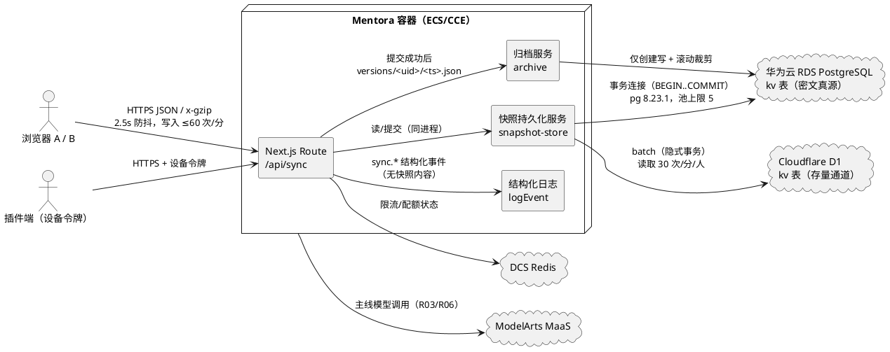
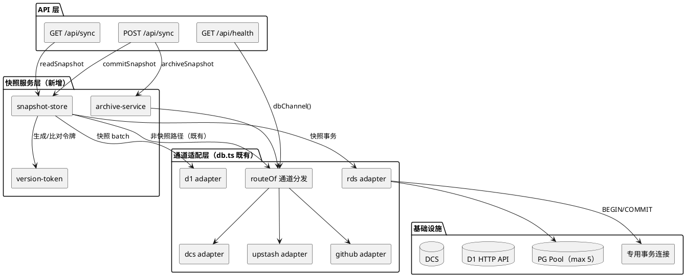
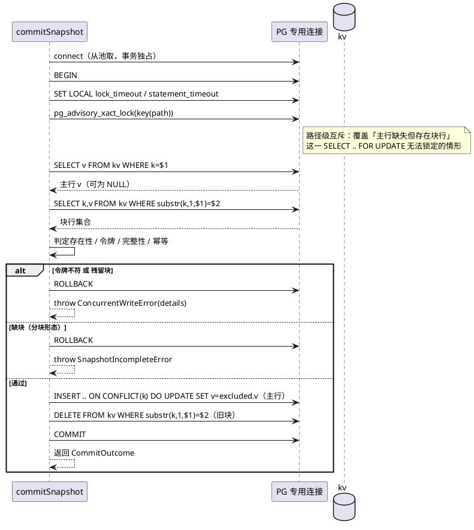
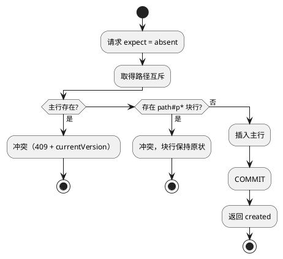
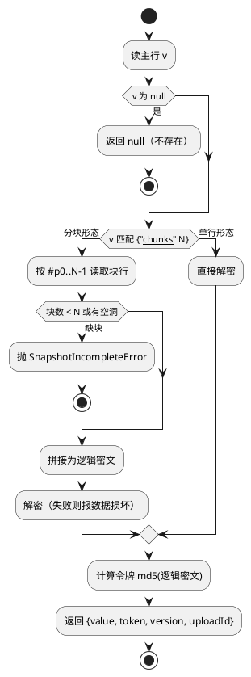
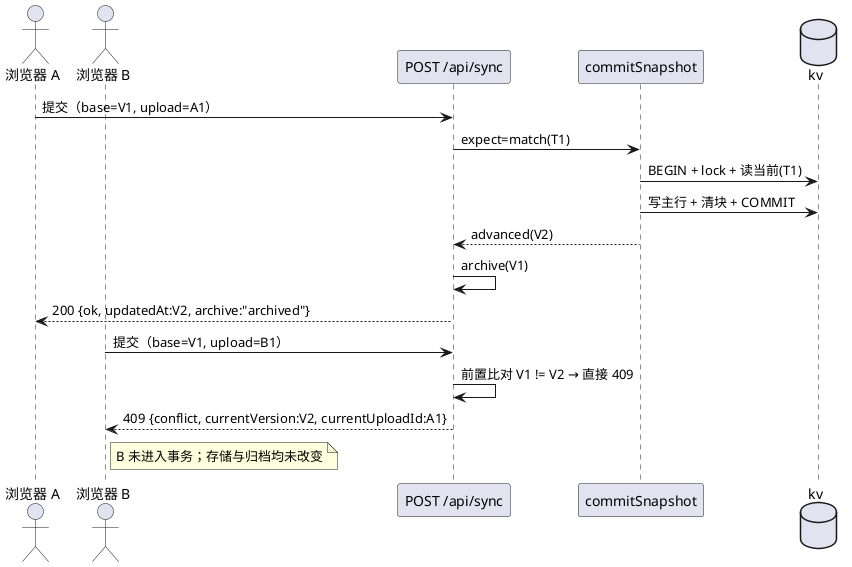
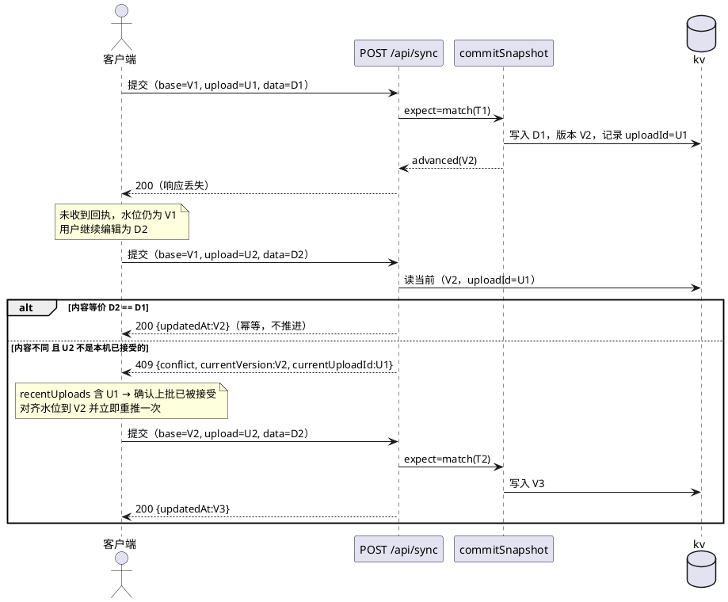
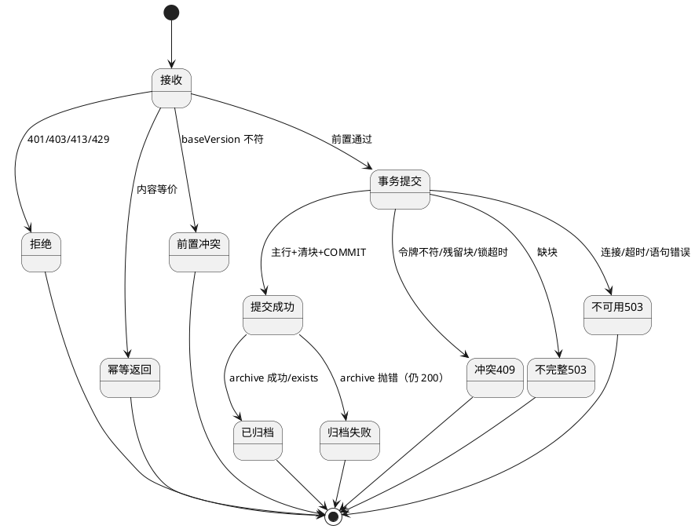
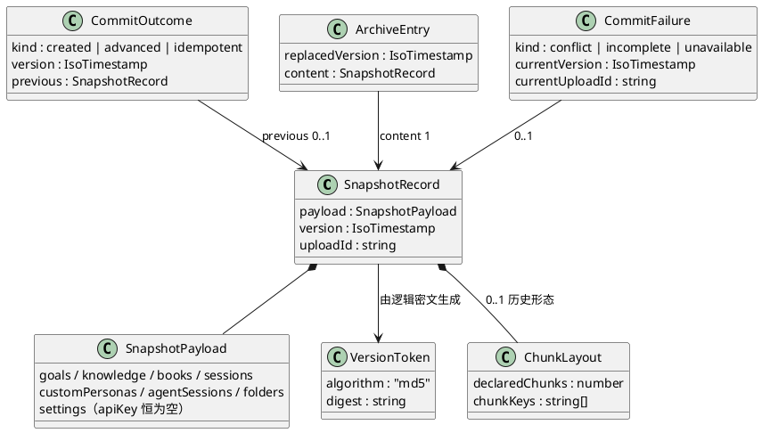

# Mentora 华为 ICT 创新赛赛题一参赛版 技术设计

- 设计标识：`ict_track1_2026_11_20`
- 版本：1.0
- 日期：2026-11-20
- 上游规格：`.codeartsdoer/specs/ict_track1_2026_11_20/spec.md`（73 条 EARS，P0 59 / P1 14）
- 目标代码栈：Next.js 16 + TypeScript（tsc 门禁）、vitest 5、pg 8.23.1、ioredis 6
- 证据口径：全文与 `docs/evidence/ict-track1-2026-11-20/` 统一使用 `PASS / FAIL / BLOCKED / NOT_RUN` 四态；本地等价验证不得提升云端条目为 `PASS`

---

# 一、需求与存量功能关系分析

## 1.1 需求功能与存量功能对比

### 1.1.1 已实现功能

判定依据：本轮实际读取工作区源码，逐处核对接口契约与业务规则，未引用历史文档结论。

| 需求功能 | 存量功能 | 代码位置 | 匹配度 |
| --- | --- | --- | --- |
| REQ-04-18 非快照读写、存在性写入、删除、列目录 | `dbGet/dbPut/dbPutIfAbsent/dbList/dbDelete/dbDeleteDir` 分通道分发，RDS/DCS/D1/Upstash/GitHub 五通道齐备 | `src/lib/server/db.ts:710-921` | 100% |
| 学习快照加密与压缩（密文透传，密钥不上云） | `encrypt/decrypt`：gzip level 6 + AES-256-GCM + `GZ1.` 前缀；`sanitize` 强制 `settings.apiKey=""` | `db.ts:35-58`、`src/app/api/sync/route.ts:31-39` | 100% |
| D1 通道分块快照读写与版本令牌 | `d1ReadSnapshot` 主行 header + `#p0..#pN`，token 为结构元组；`d1WriteSnapshot` 用临时 gate 行把清块/写块/写主行收进同一 batch | `db.ts:252-303` | 100% |
| 请求体积闸与解压炸弹闸 | 4.2MB 声明闸 + 流式字节闸 + `gunzipSync({maxOutputLength})` + 读侧 UTF-8 字节计量 | `sync/route.ts:156-193,118-135` | 100% |
| 认证、账户头、限流 | `verifyAnyAuth`、`x-mentora-user-id` 比对、读写分桶限流 | `sync/route.ts:75-83,146-154` | 75%（跨账户返回 409，见 D-06） |
| 相同内容不推进版本 | `isDeepStrictEqual(cur.data, payload.data)` 提前返回原 `updatedAt`，且该判定位于基线校验之前 | `sync/route.ts:209-211` | 100%（语义正确，缺 uploadId 维度） |
| 版本时间戳单调递增 | `new Date(Math.max(Date.now(), previousTime + 1))` | `sync/route.ts:228-229` | 100% |
| 归档上一版本并滚动保留 10 份 | `archivePrevious`：`versions/<uid>/<ts>.json`，`existing.some(n >= ts)` 去重，超出按最旧删除，失败只 `logEvent` | `sync/route.ts:45-70,251-252` | 75%（去重存在读后写窗口，见 D-08） |
| 客户端同步水位与丢回执识别 | `rememberUpload` 记录 receipt、`acknowledgedUpload` 判定云端回显、`markSyncWatermark` 记账 | `src/lib/auth-client.ts:34-61,86-109` | 75%（只在拉取侧生效，推送侧无恢复路径） |
| 同步决策纯函数（拉/推/冲突/不动） | `decideSyncAction` 18 条行为测试覆盖 | `src/lib/sync-decision.ts:55-96` | 100% |
| 运行标识可查询 | `/api/health` 返回 `build: buildSha()`，容器注入 `APP_BUILD_SHA` | `src/app/api/health/route.ts:11-20`、`src/lib/server/deploy-env.ts:44-47` | 50%（无页面可见标识） |
| 容器构建与部署资产 | 双阶段 Dockerfile、CCE 清单、compose、`deploy/hw/*.ps1`、`scripts/deploy-hw-build.mjs`（替换镜像 tag 与 `APP_BUILD_SHA`） | `Dockerfile`、`deploy/`、`scripts/deploy-hw-build.mjs` | 100%（资产齐备，云端执行未做） |
| RDS/DCS schema 初始化与迁移 | `scripts/init-rds-schema.mjs`（三表幂等）、`scripts/migrate-to-rds.mjs`（密文透传 + 对账 + 抽样解密） | `scripts/` | 100% |

### 1.1.2 需要扩展的功能

| 需求功能 | 存量功能 | 差异说明 | 扩展方向 |
| --- | --- | --- | --- |
| REQ-04-05 写入与旧块清理原子 | `rdsPut` 无条件/条件/首次三个分支各自执行「主行写」与「清块」两条独立语句 | 两次 `pool.query` 之间连接可被回收，中间无事务；主行成功、清块失败即「报失败但数据已变」（D-01） | 引入事务原语：单连接 `BEGIN → 路径级互斥 → 读当前 → 条件判定 → 主行写 → 清块 → COMMIT`，异常统一 ROLLBACK |
| REQ-04-04 残留分块视为已存在 | `expectSha === null` 只做 `INSERT ... ON CONFLICT DO NOTHING`；D1 的 gate 条件也只比对主行与 `#p0` | 「只有块行、无主行」被判定为不存在，写入后清掉块行（D-02）；D1 存在同一缺口 | 存在性判定改为「主行存在 **或** 任何 `path#p*` 行存在」，判定与写入同处一个互斥区间 |
| REQ-04-06 历史分块兼容读取 | `rdsGet` 直接返回主行 `v`；`d1Get` 缺块时按 `?? ""` 静默补空 | RDS 会把 `{"__chunks__":N}` 当密文解密 → 抛错 → 接口 503（D-03）；D1 归档路径缺块返回部分内容 | 新增 RDS 快照读取（识别 header、按序拼接、缺块抛不完整）；`d1Get` 缺块改为抛 `SnapshotIncompleteError` |
| REQ-04-12 冲突响应携带当前版本 | 条件写失败分支只返回 `conflict:true` | 客户端无法定位当前版本（D-04） | `ConcurrentWriteError` 携带冲突发生时事务内读到的 `currentVersion` 与 `currentUploadId`；D1 路径失败后补读一次 |
| REQ-04-07 版本标识同源 | `rdsGetSha` 用 SQL `md5(v)`；`dbGet(forSnapshotWrite)` 用 `crypto.md5(raw)`；对外 `version` 用 `updatedAt` | 三处口径并存，且分块形态下 `md5(header)` 不等于逻辑内容哈希 | 定义唯一内部令牌 `VersionToken = md5(逻辑密文)`（分块先拼接），对外 `version` 保持 `updatedAt` 不变 |
| REQ-04-09 归档不重复 | `dbList` 预检 `existing.some(n >= ts)` 后再 `dbPut` | 预检与写入非同一步，两个推进者可同时判定「未归档」并互相覆盖 | 归档写入改用「仅创建」语义（首次创建条件写），已存在即跳过 |
| REQ-04-13 丢回执可恢复 | 客户端仅记录 receipt；服务端只回显 `uploadId` | 服务端已接受、客户端未收到回执后继续编辑重推 → 基线过期 → 409；若直接放行旧基线则可能覆盖他人改动 | **保留既有幂等语义**：内容等价即返回当前版本、不推进不归档；内容不同仍 409，不提供任何隐式推进。客户端在三条保护同时成立时才对齐水位并重推一次（1.2.4） |
| REQ-04-15 跨账户隔离 | 账户头不一致返回 409 | 409 语义属「并发冲突」，与隔离语义混用（D-06） | 改为 403 + 专用 `code`，不泄露对方数据 |
| REQ-04-19 行为级验收证据 | `sync-conflict-409.test.ts` 读源码正则 | 无连接、无并发、无存储断言（D-05） | 新增临时 PostgreSQL 容器集成用例 + 真实 D1 隔离键用例 + 失败注入；源码匹配测试降级为「契约结构锁」，不计入并发证据 |
| REQ-05-04 运行标识一致 | `/api/health` 的 `build` 字段 | 在线入口页面不展示 | 页脚只读运行标识（服务端读取同一 `buildSha()`），与 health 同源 |
| REQ-04-20 失败可诊断 | 归档路径有 `logEvent`，冲突路径无结构化记录 | 冲突/不完整/通道失败缺统一事件 | 统一 `sync.*` 结构化事件（事件类型、路径摘要、结果分类、耗时，不含内容与完整账号） |

### 1.1.3 需要新增的功能或接口

按模块分组，标注输入、输出、核心逻辑与依赖关系。

**（1）快照持久化服务（`src/lib/server/snapshot-store.ts`，新增文件）**

- `readSnapshot(path): Promise<SnapshotRead | null>`
  - 输入：KV 路径（`data/<uid>.json`）。
  - 输出：`{ value, token, version, uploadId }`，或 `null`（不存在），或抛 `SnapshotIncompleteError`。
  - 核心逻辑：主行存在性判定 → header 识别 → 块行按序拼接 → 密文完整性校验 → 令牌与版本生成。
  - 依赖：`kv` 表、`encrypt/decrypt`、通道适配（RDS 走事务连接，D1 走 batch/查询）。
- `commitSnapshot(path, payload, expect): Promise<CommitOutcome>`
  - 输入：路径、待写对象、`expect`（可辨识联合：`absent` / `match(token)` / `unconditional`）。
  - 输出：`{ kind: "created" | "advanced" | "idempotent", version, token, previous }`。
  - 核心逻辑：单事务内的读 → 幂等判定 → 条件判定 → 主行写 → 清旧块 → 提交。
  - 依赖：`pg` 连接池专用连接、`advisory lock`、`ConcurrentWriteError`。
- `listArchives(userId)` / `archiveSnapshot(userId, entry)`
  - 输出：归档时间戳列表；归档写入结果 `"archived" | "exists" | "failed"`。
  - 核心逻辑：仅创建语义写入 + 滚动裁剪。
  - 依赖：通道层 `dbList/dbPut` 或直连通道原语。

**（2）错误类型与类型契约（`db.ts` 内新增导出）**

- `ConcurrentWriteError`（已有）扩展 `details: { currentVersion: string | null; currentUploadId?: string }`。
- `SnapshotIncompleteError`（新增）：`{ path, declaredChunks, foundChunks }`，用于 REQ-04-06 缺块。
- `Expectation` 可辨识联合类型（新增）：替代 `string | null | undefined` 的三态参数，消除 `undefined` 与 `null` 的语义混淆。

**（3）接口契约（`/api/sync` 扩展，不改既有字段语义）**

- `GET` 响应新增可选 `uploadId`（已有）、`version`（已有）；错误响应新增可选 `code`。
- `POST` 409 响应新增 `currentVersion`（P0）与 `currentUploadId`（P0）；成功响应新增可选 `archive`（`"archived" | "exists" | "failed"`）。
- 新增 `403 ACCOUNT_MISMATCH`、`503 SNAPSHOT_INCOMPLETE`、`503 DB_UNAVAILABLE` 三种带 `code` 的失败形态。

**（4）参赛交付脚本（新增，均不改业务源码）**

- `scripts/freeze-ict-snapshot.mjs`：参赛快照清单、摘要、密钥扫描、重建说明（R01）。
- `scripts/verify-snapshot-rds.mjs`：临时 PostgreSQL 容器生命周期 + 集成用例执行 + JSON 报告（R04 证据）。
- `scripts/audit-cloud-budget.mjs`：云资源只读盘点 + 预算前置校验（R03，受凭据阻塞）。
- `docs/evidence/ict-track1-2026-11-20/` 目录骨架与 `EVIDENCE-TEMPLATE.md`（R08）。

**（5）展示层小改动**

- 页脚/设置页运行标识（读取 `buildSha()`），满足 REQ-05-04；不改任何业务逻辑。

## 1.2 存量功能详细分析

### 1.2.1 D1 通道快照原语（`db.ts:252-303`）

- **接口契约**：`d1ReadSnapshot` 返回 `{ raw, token }`。`token = JSON.stringify([header, parts[0] ?? null])`——非分块时为 `[整段密文, null]`，分块时为 `[{"__chunks__":N}, 首块]`。`d1WriteSnapshot(path, content, token)` 的 `token` 由上一次读取产生。
- **业务规则**：
  1. 小内容且旧值非分块 → 单语句 `UPDATE ... WHERE v = header` 或 `INSERT ... DO NOTHING`。
  2. 其余情形 → 单 batch：插 gate 行（条件为「主行 = header 且 `#p0` = first」）→ 删旧块（`EXISTS gate`）→ 写新块（`EXISTS gate`）→ 写主行（`EXISTS gate`）→ 删 gate。
  3. 首条语句未返回行 = 竞争失败 → `ConcurrentWriteError`。
- **扩展点**：gate 行的存在即「本次写入已获准」的唯一凭据，所有后续语句以它为闸；新增校验只需扩展 gate 的插入条件。
- **约束**：依赖 D1 `batch` 的事务语义（平台行为，本地无法等价复现）；`token` 内含首块内容，**只能服务端内部流转**，绝不可作为对外版本标识（非分块时可达数百 KB）。
- **已识别缺口**：gate 条件不检查 `path#p1..` 是否存在，残留块行会被误判为「不存在」（对应 D-02 的 D1 版本）。

### 1.2.2 RDS 通道写入（`db.ts:443-501`）

- **接口契约**：`rdsGet` 返回主行 `v` 原文；`rdsGetSha` 返回 `md5(v)`；`rdsPut(path, content, expectSha?)` 三态：`undefined` 无条件、`null` 期望不存在、字符串条件匹配。
- **业务规则**：
  1. 无条件写 → `INSERT ... ON CONFLICT DO UPDATE`，随后一条独立 `DELETE ... substr` 清块。
  2. 期望不存在 → `INSERT ... DO NOTHING RETURNING k`，0 行即冲突，随后独立清块。
  3. 条件匹配 → `UPDATE ... WHERE k=$1 AND md5(v)=$3 RETURNING k`，0 行即冲突，随后独立清块。
- **约束**：
  1. 每次 `pool.query` 独立取还连接，**三条语句不在同一事务**（D-01 的根因）。
  2. 期望不存在不检查块行（D-02）。
  3. 读取不识别 header（D-03）。
  4. 条件写与 `dbGet(forSnapshotWrite)` 的令牌生成在两处，口径靠「密文为 ASCII」这一事实保平（见 2.4 论证）。
  5. `rdsPool()` 的最小类型 `PgPool` 只有 `query`，无法获取专用连接；这是事务化的前置改造点。
- **扩展点**：`dbPut` 的 `compareSnapshot` 已具备把「条件写」意图传给通道层的通路，但当前以 `overwriteOnConflict:true` 同时传入，优先级依赖 `dbPut` 里的三元表达式（易读性差、易误用）。

### 1.2.3 `/api/sync` 决策链与并发窗口（`sync/route.ts:145-257`）

执行顺序与每一步的并发窗口：

1. 鉴权 → 账户头比对（当前 409）。
2. 限流（读 30/分、写 60/分）。
3. 体积闸（声明 + 流式 + 解压上限）。
4. 解析并 `sanitize`（`apiKey` 清空、folders 截断 10000）。
5. `dbGet(snapPath, {encrypted, forSnapshotWrite})` —— **窗口 W1**。
6. 缺省 folders 补齐（读旧值）。
7. 同内容幂等判定 —— 依赖 W1 的读。
8. `baseVersion` 与 `cur.updatedAt` 比对 —— **窗口 W2**（W1 之后、写入之前）。
9. 生成单调递增 `updatedAt`。
10. `dbPut(..., {compareSnapshot:true, overwriteOnConflict:true, sha:cur._sha})` —— **条件写兜底 W2**。
11. `archivePrevious` —— **窗口 W3**（写入成功之后、归档之前）。

**结论**：W2 由条件写兜底是正确的；W3 与主写不在同一原子单元（这是有意的，见 2.6）；W1 会在 RDS 上因分块 header 解密失败而中断（D-03）。

### 1.2.4 客户端同步状态机（`auth-client.ts`）

- **状态量**：`syncChoiceKey()`（服务端 `updatedAt` 水位）、`dirtyKey()`（本机编辑标记，值为 `<单调计数>:<随机>`）、`recentUploadsKey()`（最近 8 条 `{id, edit}` 回执）。
- **行为**：
  1. 本地字段变化 → `markLocalEdit()` → 2.5s 防抖 `pushCloud()`。
  2. `pushCloud` 默认 `baseVersion = getSyncWatermark()`；每次尝试生成**新** `uploadId`（`rememberUpload` 在请求体构造时调用一次，重试复用同一 text）。
  3. 409 时读取 `conflict === true` 并置 `syncStatus="conflict"`，不重试、不拉取。
  4. 成功时以响应 `updatedAt` 更新水位，并在编辑标记未变时清除 dirty。
- **已识别缺口**：丢回执后水位仍是旧值，后续每次推送都会 409；`acknowledgedUpload` 只在 `bootSync/syncAfterLogin` 的决策输入里生效，无法把「已成功但未收到回执」转成可写状态（REQ-04-13 不满足）。
- **对齐重推的三条保护**（沿用现有 `acknowledgedUpload` / `rememberUpload` 语义，缺一不可）：
  1. **归属**：409 的 `currentUploadId` 必须命中本机 `recentUploads`，且该回执的账户与当前登录账户一致；命中项还需满足 `edit < 当前 edit`（当前编辑晚于该次上传），否则视为「当前版本并非本机该批上传产生」。
  2. **编辑时序**：仅当本机存在晚于该次上传的新编辑时才允许重推；无新编辑说明本地已无待同步内容，直接对齐水位并结束，不发第二次请求。
  3. **内容完整性**：本机快照必须包含云端当前快照的全部文件/条目，不存在「云端有、本机缺失」的对象。409 响应体不足以核实完整性时，先 `GET /api/sync` 读取云端状态逐项核对；核对不通过则进入冲突态，不进重推分支。
- **重推边界**：最多 1 次，使用新 `uploadId`、新基线与当前 `localData()`；重推期间产生的新编辑必须保留 dirty 标记（不得因本次重推成功而被误清），留给下一轮同步。
- **约束**：`getSyncWatermarkTs()` 用 `Date.parse`，若版本标识改为非时间格式，会退化为 0 并破坏 `decideSyncAction` —— 因此对外版本标识必须继续是 ISO 时间字符串（见 2.4 决策 D-2）。

### 1.2.5 上一轮初步修改的审查与取舍

事实来源：`git diff` 对比 HEAD（`facf520`），三处未提交修改均属上一轮 Codex，**不计入本轮码道产出**（REQ-02-03）。

| 初步修改 | 判定 | 取舍与理由 |
| --- | --- | --- |
| `ConcurrentWriteError`（新增导出类） | 保留 | 上层区分冲突所需的最小类型；扩展 `details` 而非另建类型 |
| `rdsGetSha`（`SELECT md5(v)`） | 保留但收敛 | 与 `dbGet(forSnapshotWrite)` 的 `crypto.md5(raw)` 重复；统一由 `VersionToken` 生成器承担，`rdsGetSha` 仅作为通道原语保留 |
| `rdsPut(expectSha)` 条件 `UPDATE ... md5(v)=$3 RETURNING k` | **保留语句，修正边界** | 语句本身是 PG 单语句原子，正确；但清块在语句外，必须纳入同一事务（D-01 未修）；`expectSha === null` 未检查块行（D-02 未修） |
| `dbGet(forSnapshotWrite)` 返回 `_sha = crypto.md5(raw)` | **修正** | 分块形态下 `raw` 是 header 而非逻辑密文，令牌错误；改为「先还原逻辑密文再算令牌」 |
| `dbPut` 优先级 `compareSnapshot ? ... : overwriteOnConflict ? undefined : sha` | **修正** | 三元嵌套把「未声明基线」与「期望不存在」混为一谈（`sha===undefined` 时 `compareSnapshot:true` 等价于 `absent`），是危险默认；改为可辨识联合 `Expectation`，`compareSnapshot` 语义收窄为「快照专用条件写」 |
| `d1ReadSnapshot` / `d1WriteSnapshot`（D1 快照 token + gate 事务） | 保留 | 修掉了 D1 的「先清块后写主行」非原子问题，且保持旧块布局可被旧版本读；本轮补 gate 的残留块检查 |
| `sync/route.ts`：`dbGet(forSnapshotWrite)` + 同内容幂等 + `baseVersion` 前置校验 + 条件写 | 保留 | 幂等判定先于基线校验的顺序是正确的（否则重复提交会 409）；基线前置校验提供快速 409 |
| `sync/route.ts`：409 条件写分支不返回 `currentVersion` | **修正** | D-04；改为从冲突异常携带的 `details` 取值 |
| `sync/route.ts`：旧块清理移到主行写入之后 | **部分否决** | 移动顺序只改变「主行成功后残留块」的表现，不改变原子性；正确解法是把两者放进同一事务。顺序调整在事务内自然满足（主行 → 清块），无需额外语义 |
| `sync/route.ts`：`archivePrevious` 移到写入之后 | 保留 | 正确表达「只有推进者归档」；但归档写入需改为仅创建语义 |
| 账户头不一致返回 409 | **修正** | REQ-04-15 要求 403/404；409 与并发冲突混用会污染客户端冲突态 |
| `withBudget` 定时器清理、`remote-response` 统一超时、`d1Init/rdsInit` 失败不缓存、`upstashList` 去重与游标兜底、`folders` 截断、读侧 UTF-8 字节计量、`gzip level 6` | 保留（与本需求正交） | 均为独立健壮性修复，不改变快照并发语义；回归时一并覆盖 |
| `sync-conflict-409.test.ts` 源码正则 | 保留但降级定位 | 作为「契约结构锁」防止关键语句被误删；在文件头标注「不作为 REQ-04-19 证据」，实际并发证据由新增集成测试承担 |

---
# 二、增量设计方案

## 2.1 实现模型

### 2.1.1 上下文视图



通信协议与频率：浏览器↔Route 为 HTTPS + JSON/gzip，写入路径由 2.5s 防抖与 60 次/分限流约束；Route↔RDS 为 TCP + pg 协议，单次提交 1~3 个往返（事务内 3~5 条语句）；Archive 路径每次推进额外 2~4 次往返；本地等价验证与云端验证使用同一协议栈，仅实例来源不同。

### 2.1.2 服务/组件总体架构



组件职责与依赖频率：`snapshot-store` 是唯一持有快照并发语义的组件（每次同步读写各 1 次调用）；`archive-service` 仅在推进路径调用；`version-token` 为纯函数，无 I/O；通道适配层中 `rds/d1` 走快照原语，`dcs/upstash/github` 只承载非快照数据（`rl/ code/ quota/ loginfail/` 与 `users/ events/`）。

配置项与取值策略：

| 配置 | 取值 | 作用 |
| --- | --- | --- |
| `DB_CHANNEL` | `huawei`（参赛）/`auto`（默认） | 决定快照落 RDS 还是 D1；`huawei` 缺凭据 fail-fast，不静默换道 |
| `SNAPSHOT_LOCK_TIMEOUT_MS` | 默认 2000 | 事务内路径锁等待上限，超时映射 409（可重试冲突） |
| `SNAPSHOT_STATEMENT_TIMEOUT_MS` | 默认 8000 | 事务整体上限，保证单请求不超 `maxDuration=60` 且不长期占用池连接 |
| `SNAPSHOT_KEEP_ARCHIVES` | 10（常量） | 归档保留份数 |
| `APP_BUILD_SHA` | 部署注入 | 运行标识，与镜像 tag 一致 |

### 2.1.3 实现设计文档

#### （1）RDS 快照提交事务（核心）



事务规则（设计约束，非实现代码）：

1. **连接获取**：`pool.connect()` 取专用连接，事务期间**禁止**调用 `rdsQuery`（它会另取连接，破坏原子性）；连接接口需从「只有 query」扩展为「query + release」。
2. **互斥键**：`pg_advisory_xact_lock(hashtextextended($path, 0))`（PG 11+，RDS PG15 可用）。哈希碰撞只会让不同路径额外串行，不产生错误判定；事务结束自动释放。备选 `('x'||md5($path))::bit(64)::bigint`，在 PG 版本不确定时使用。
3. **条件判定在事务内完成**，写法按 `Expectation` 分三支：
   - `absent`：`主行不存在 且 不存在任何 path#p*` → 允许；否则冲突。**不得**用 `INSERT ... ON CONFLICT DO NOTHING` 单独承担该语义，因为它看不见块行。
   - `match(token)`：比较「逻辑密文」的令牌（分块先拼接）。等价 SQL 形态为 `md5(拼接后的密文) = token`，但拼接在应用层完成，比较也在应用层完成——仍在同一事务、同一把锁内，因此与原 `UPDATE ... WHERE md5(v)=$3` 等价原子；差别是能覆盖分块形态。
   - `unconditional`：不做条件判定（迁移/初始化/归档专用）。
4. **写入顺序**：先 `UPSERT` 主行，再删块行。事务内该顺序不改变原子性，但保证「若后续步骤失败，主行也已回滚」；同时让「旧版本回读」在极端情况下仍看到完整旧值。
5. **失败语义**：
   - 判定失败 → `ROLLBACK` → `ConcurrentWriteError`（携带 `currentVersion/currentUploadId`，来自同一事务内已读到的值，无需二次读）。
   - 缺块 → `ROLLBACK` → `SnapshotIncompleteError`（主行与块行保持原状）。
   - 锁超时（`55P03`）→ `ROLLBACK` → `ConcurrentWriteError`（标记 `reason:"lock-timeout"`）。
   - 序列化失败（`40001`/`40P01`）→ `ROLLBACK` → 重试 1 次；仍失败 → `ConcurrentWriteError`。
   - 网络/连接失败 → `ROLLBACK`（尽力）→ `DbUnavailableError` → 接口 503。
6. **回滚保证**：任何 `throw` 路径必须先 `ROLLBACK` 再 `release()`；`release()` 需带 `destroy` 标记处理连接已不可用的情况（避免脏连接回池）。

#### （2）首次创建与残留块（REQ-04-03 / 04-04）



设计要点：两路首次创建由路径互斥串行化，后到者看到主行或块行即冲突；即使互斥失效，`kv.k` 主键的唯一约束仍是最后防线（`INSERT` 会失败而非覆盖）。

#### （3）历史分块快照读取与迁移（REQ-04-06）



写入迁移路径：任何一次成功推进都会把「主行 header + 块行」改写为「单行密文」，并在同一事务内删除块行。因此**分块形态是自愈的**：读→写一次即完成迁移，无需独立迁移脚本。回退兼容性：单行密文对旧版本可读（旧版 `rdsGet` 直接解密），旧版本写入后若产生块行也可被新版本读取——双向兼容，满足 4.5.6 与 5.4.3 第 4 条。

#### （4）并发冲突时序（REQ-04-01 / 04-02 / 04-12）



补充：若 B 在 A 提交前已通过前置比对（窗口 W2 竞争），则进入事务后令牌不匹配 → `ConcurrentWriteError` → 409，同样携带 `currentVersion`；两条路径的响应形态一致。

#### （5）丢回执恢复时序（REQ-04-13 / 04-14）



设计边界：`currentUploadId` 相等只表示「当前云端版本由本客户端上一次上传产生」，因此**允许把水位对齐到该版本**；它不会让客户端跨设备覆盖他人改动（他人写入会改变 `uploadId`）。重推还须同时满足 1.2.4 的三条保护（账户与本机归属、当前编辑晚于该次上传、云端无本机缺失对象）；409 响应不足以核实完整性时先读取云端状态核对。重推最多 1 次，避免循环；重推期间产生的新编辑保留 dirty 标记。

#### （6）写入结果状态机



关键规则：`提交成功` 是唯一允许写入归档的状态；`冲突409` 与 `幂等返回` 一律不归档（REQ-04-08）；`归档失败` 不改变响应成功语义，但必须产生可检索事件（4.2.4）。

#### （7）D1 通道对齐（REQ-04-17）

D1 保持既有 gate/batch 结构，仅做三处**语义对齐**，不改变语句形态与块布局：

1. gate 插入条件追加「主行存在 或 不存在任何 `#p*`」，用于覆盖残留块（REQ-04-04）。
2. `d1Get` 缺块改为抛 `SnapshotIncompleteError`，不再 `?? ""` 静默补空（REQ-04-06）。
3. 条件写失败时补读一次当前快照，取 `updatedAt/uploadId` 填入 `ConcurrentWriteError.details`（REQ-04-12）。

D1 的原子性依赖 `batch` 的平台事务语义，本地无法等价复现；该项证据口径为「真实 D1 通道验证（非华为云）」加「云端待验证」，不得表述为 RDS 已验证。

## 2.2 接口设计

### 2.2.1 总体设计

接口分三层，稳定性等级按下表：

| 层 | 接口 | 稳定性 | 说明 |
| --- | --- | --- | --- |
| HTTP | `GET /api/sync` | 稳定 | 字段只增不改；`version` 恒为 ISO 时间串 |
| HTTP | `POST /api/sync` | 稳定 | 新增 `archive`、`currentVersion`、`currentUploadId`、`code` 为可选字段 |
| 服务 | `readSnapshot` | 稳定 | 只读，不改存储 |
| 服务 | `commitSnapshot` | 稳定 | 唯一写入入口，事务边界在此收口 |
| 服务 | `archiveSnapshot` | 实验 | 参赛版新增，允许后续调整返回细分 |
| 通道 | `rdsPut/d1WriteSnapshot` | 内部 | 不对外；语义收紧后仅供 `commitSnapshot` 调用 |
| 通道 | `dbGet/dbPut/dbPutIfAbsent/dbList/dbDelete` | 稳定 | 非快照路径语义不变 |

接口变更策略：`version` 不改为内容哈希（会破坏客户端 `Date.parse` 水位）；若未来引入 `versionToken` 对外字段，只做新增，客户端按能力探测启用。

### 2.2.2 接口清单

#### （1）`readSnapshot`

- 签名：`readSnapshot(path: string): Promise<SnapshotRead | null>`
- 业务说明：读取一份快照的**逻辑内容**与**并发令牌**，供拉取与写入前置校验使用。
- 前置条件：通道已就绪；`path` 为快照路径（`data/<uid>.json` 或 `versions/<uid>/<ts>.json`）。
- 后置条件：无写入；返回值中的 `token` 仅为服务端内部值，绝不进入 HTTP 响应。
- 异常映射：缺块 / 解密失败 → `SnapshotIncompleteError` → HTTP 503 `code:"SNAPSHOT_INCOMPLETE"`。
- 调用契约：`SnapshotRead = { value: SnapshotPayload; token: VersionToken; version: string; uploadId?: string }`。

#### （2）`commitSnapshot`

- 签名：`commitSnapshot(path: string, payload: SnapshotPayload, expect: Expectation): Promise<CommitOutcome>`
- 业务说明：在单一原子单元内完成「存在性判定 → 令牌判定 → 幂等判定 → 主行写 → 旧块清理」。
- 前置条件：调用方已完成鉴权、体积闸、`sanitize`；`expect` 必须显式给出（禁止缺省）。
- 后置条件：成功时存储中只有一份逻辑内容，块行数不超过新内容所需；失败时主行、块行、归档集合与调用前逐字节一致。
- 异常映射：
  - `ConcurrentWriteError` → 409 `{conflict:true, currentVersion, currentUploadId?}`
  - `SnapshotIncompleteError` → 503 `{code:"SNAPSHOT_INCOMPLETE"}`
  - `DbUnavailableError` → 503 `{code:"DB_UNAVAILABLE"}`
- 调用契约：
  - `Expectation = { mode: "absent" } | { mode: "match"; token: VersionToken } | { mode: "unconditional" }`
  - `CommitOutcome = { kind: "created" | "advanced" | "idempotent"; version: string; token: VersionToken; previous: SnapshotRecord | null }`

#### （3）`archiveSnapshot`

- 签名：`archiveSnapshot(userId: string, previous: SnapshotRecord | null): Promise<ArchiveOutcome>`
- 业务说明：把被替换的上一版本写入 `versions/<uid>/<ts>.json`，并裁剪至最近 10 份。
- 前置条件：主写入已 COMMIT；`previous` 来自该次事务内读到的旧值（不是二次读）。
- 后置条件：同时间戳归档最多一份；失败不抛给调用方，只返回 `"failed"` 并记事件。
- 异常映射：内部捕获，返回 `ArchiveOutcome = "archived" | "exists" | "failed"`。
- 语义边界：归档失败**不**回滚主写入（4.2.4），但响应 `archive:"failed"` 与 `sync.archive_failed` 事件同时留痕。

#### （4）HTTP 契约

| 方法与路径 | 场景 | 状态码 | 响应体（新增字段以 ★ 标注） |
| --- | --- | --- | --- |
| GET `/api/sync` | 拉到快照 | 200 | `{data, updatedAt, version, uploadId}` |
| GET `/api/sync?versions=1` | 归档列表 | 200 | `{versions:number[]}` |
| GET `/api/sync?v=<ts>` | 指定归档 | 200 | 同上（归档缺失 → `{data:null}`） |
| GET/POST | 未认证 | 401 | `{error}` |
| GET/POST | 账户头与认证账户不一致 | 403 | `{error, ★code:"ACCOUNT_MISMATCH"}`（原 409，见 2.8 决策 D-5） |
| POST | 同内容重复提交 | 200 | `{ok:true, updatedAt, ★version}`（不推进、不归档） |
| POST | 推进成功 | 200 | `{ok:true, updatedAt, ★version, ★archive}` |
| POST | 基线不符（前置比对） | 409 | `{error, conflict:true, currentVersion, ★currentUploadId}` |
| POST | 基线不符（事务内令牌） | 409 | 同上（`currentVersion` 取自冲突异常） |
| POST | 缺少 `data` | 400 | `{error}` |
| POST | 超体积 | 413 | `{error}` |
| POST | 限流 | 429 | `{error}` |
| GET/POST | 缺块 | 503 | `{error, ★code:"SNAPSHOT_INCOMPLETE"}` |
| GET/POST | 通道不可用 | 503 | `{error, ★code:"DB_UNAVAILABLE"}` |

前端字段兼容：客户端只读取 `ok`、`updatedAt`、`conflict`、`currentVersion`、`currentUploadId`；新增字段对旧客户端无影响。

## 2.3 数据模型

### 2.3.1 设计目标

- 支持四类场景：单行快照、历史分块快照、归档版本、并发提交。
- 性能目标：≤4.2MB 请求体 P95 ≤2.5s；≤8MB 分块快照提交/读回 ≤6s；冲突判定 ≤3s。事务内语句数为常量级，令牌计算为一次 MD5（毫秒级）。
- 容量目标：单账号归档 10 份；单行上限受 PG TEXT 约束（1GB），业务上限由 64MB 解压闸约束。
- 兼容目标：对 D1 存量键布局（`{"__chunks__":N}` + `#p0..`）零迁移成本读取；写入后自愈为单行；旧版本可读新数据。

### 2.3.2 模型实现



- **对象关系**：`SnapshotRecord` 组合 `SnapshotPayload`；`ChunkLayout` 是历史形态的可选描述（0..1），仅存在于「读到旧数据」的瞬间；`CommitOutcome.previous` 为 0..1（首次创建为 0）。
- **创建与销毁**：`SnapshotRecord` 由 `readSnapshot`/`commitSnapshot` 生成，不缓存跨请求；`ChunkLayout` 的生命周期止于一次成功写入（迁移即销毁）。
- **持久化策略**：`kv(k TEXT PRIMARY KEY, v TEXT NOT NULL)`，`v` 为密文（`GZ1.` + base64）；分块形态仅在存量数据中出现，新写入不再产生块行。归档与快照同表不同前缀（`versions/<uid>/<ts>.json`），便于统一 `dbList` 与级联删除。
- **令牌不落库**：令牌由「逻辑密文」即时计算，不新增列、不改 schema，避免迁移期双写与回填。

## 2.4 版本令牌与历史分块迁移

### 2.4.1 现状的三套口径

| 位置 | 表达式 | 依据 | 问题 |
| --- | --- | --- | --- |
| `rdsGetSha` | SQL `md5(v)` | PG 内置函数，对 text 的字节算 MD5 hex | 分块形态下算的是 header `{"__chunks__":N}`，不是内容 |
| `dbGet(forSnapshotWrite)` RDS | `crypto.md5(raw, "utf8")` | Node 侧对读取到的字符串 | `raw` 同样可能是 header；与上一行重复计算 |
| `rdsPut` 条件写 | SQL `md5(v)` | PG 内置 | 无法表达「拼接后内容」的哈希 |
| D1 token | `JSON.stringify([header, firstChunk])` | 结构元组 | 非分块时 token 含整段密文（可达 380KB），绝不能出网 |
| 对外 `version` | `updatedAt` | payload 内的 ISO 时间 | 与上述内部令牌不同源，靠服务端二次读取配合 |

### 2.4.2 一致性论证

**结论一：`crypto.md5` 与 PG `md5()` 对同一密文恒等，可安全统一到任一侧。**

依据：密文 payload 的字符集为 `GZ1.` 前缀 + Base64 字母表（`A-Za-z0-9+/=`），全部是 ASCII。PG `md5(text)` 对数据库编码下的字节取摘要，UTF-8 与任何 ASCII 兼容编码对纯 ASCII 文本的字节序列相同；Node `crypto.md5(str, "utf8")` 亦为同一字节序列。因此两处结果必然一致，不存在「换通道后令牌漂移」。

**结论二：令牌必须定义在「逻辑内容」层，而不是「物理行」层。**

依据：分块形态下物理行是 header，逻辑内容是拼接后的密文。若令牌停留在物理行，则：
1. 「期望不存在」漏判块行（D-02）；
2. 客户端基于 header 哈希声明基线后，任何块改动都不会被发现；
3. 读到的令牌无法用于「完整内容一致」的判定（REQ-04-07）。

因此统一为：`VersionToken = "md5:" + md5(逻辑密文)`。其中「逻辑密文」定义为：单行形态 = 主行 `v`；分块形态 = `#p0` 到 `#p(N-1)` 按序无空洞拼接的结果。

**结论三：对外版本标识保持 `updatedAt`，不改为内容哈希。**

依据：`src/lib/auth-client.ts:89-99` 的 `getSyncWatermarkTs()` 用 `Date.parse` 解释水位；`sync-decision.ts:92` 用 `cloudTs > localTs + toleranceMs` 判定拉取。改为哈希会使水位恒为 0，触发「本机较新，无需拉取」的错误分支，静默丢失云端更新。REQ-04-07 的实质要求是「读取返回的标识可直接用于下次条件写」，而 `updatedAt` 满足：客户端原样回传，服务端在同一事务内读到的当前值与之比对，不一致即 409；篡改任一字节必然不等（REQ-04-07 验收条件成立）。内容令牌作为**第二道闸**在事务内兜底，用于覆盖「时间戳相同但内容不同」这一理论窗口（实际不可达，因 `updatedAt` 强制单调 +1ms）。

**结论四：令牌不得出网。**

理由：D1 非分块 token 含整段密文；任何回传都会造成密文经客户端往返，既无必要也扩大暴露面。HTTP 响应中只有 `version`（时间戳）与 `uploadId`（随机 UUID）。

### 2.4.3 历史分块快照的读取、令牌与写入迁移

| 阶段 | 行为 | 失败处理 |
| --- | --- | --- |
| 读取 | 主行正则 `/^\{"__chunks__":(\d+)\}$/` 命中即按序取块；块数不足或空洞 → 不完整 | 抛 `SnapshotIncompleteError`，接口 503，不返回部分内容（REQ-04-06、4.5.3） |
| 令牌 | 对拼接后的逻辑密文算 `md5` | 拼接失败即读取失败，不存在「半份令牌」 |
| 条件写 | 事务内比对令牌（`match`）或判定块行存在（`absent`） | 不符 → 409，块行与主行不动（REQ-04-02） |
| 写入 | 主行改写为单行密文 → 删除全部 `#p*` → COMMIT | 任一步失败整体回滚，形态保持原样（REQ-04-05） |
| 后续 | 该路径不再有块行，读取代价降为一次主行查询 | — |

**为什么不用「独立的存量迁移任务」**：迁移任务需要窗口、需要与在线写入互斥、失败后还要区分「部分迁移」。自愈式迁移把这些成本摊到每一次正常推进里，且天然具备幂等性（重复写入同一内容会命中幂等分支）。

**为什么不在 `kv` 上加 `version` 列**：加列需要 `ALTER TABLE`，云端 RDS 可执行但对既有实例引入 DDL 窗口；且列值需要回填（回填期间新旧值并存），反而制造新的不一致源。令牌即时计算在大快照上仅一次 MD5（8MB 约 10ms 量级），对 P95 ≤2.5s 无实质影响。

## 2.5 客户端幂等与丢回执

### 2.5.1 现状核对结论

| 能力 | 现状 | 结论 |
| --- | --- | --- |
| 同内容重复提交 | 服务端 `isDeepStrictEqual` 先于基线校验，返回原 `updatedAt` | 已满足 REQ-04-10，**不改** |
| 弱网同包重试 | `pushOnce` 的多次尝试复用同一 `text`（同一 `uploadId`、同一 `baseVersion`） | 首次成功、响应丢失时第二次命中幂等分支 → 不双写（REQ-04-14） |
| 丢回执后继续编辑 | 水位未更新 → 每次推送 409；`acknowledgedUpload` 只在拉取决策里生效 | **不满足** REQ-04-13，需扩展 |
| `updatedAt` 单调性 | 服务端 `max(now, prev+1ms)` | 满足 REQ-04-11，**不改** |
| 版本回显 | `GET` 返回 `uploadId`；响应 `version` 已存在 | 满足拉取侧识别，**不改** |

### 2.5.2 增量设计（三处最小改动）

1. **服务端回显冲突归属**：`ConcurrentWriteError.details` 携带 `currentVersion` 与 `currentUploadId`；POST 的 409 响应原样输出。`currentUploadId` 来自事务内读到的当前快照 payload，不额外查询。
2. **服务端允许「自我基线推进」的显式确认**：不在服务端做隐式放行（避免把「客户端声明错基线」当成合法），只提供归属信息；是否推进由客户端决定。这样服务端保持「无有效基线就拒绝」的硬边界，符合 REQ-04-03 与 4.2.1。
3. **客户端对齐一次**：`pushOnce` 收到 409 后解析 `currentVersion`/`currentUploadId`；若 `currentUploadId` 命中 `recentUploads()`（即本机上一批已被接受），则 `markSyncWatermark(currentVersion)` 并重推 **1 次**（`retries:0`），保留 dirty 标记与本地内容；不命中则维持 `syncStatus="conflict"`，进入既有「刷新/合并/导出」路径（REQ-04-21）。

设计取舍：把「是否对齐」放在客户端而非服务端，原因是服务端无法区分「同一客户端的两次编辑」与「攻击者伪造 uploadId」以外的更多语义，而客户端持有 `recentUploads` 这一权威证据；同时避免在服务端引入「上次上传递增白名单」这类需要 TTL 与存储的状态。

风险与护栏：重推次数硬上限 1；若重推仍 409，直接进入冲突态（说明期间有第三方写入），不会无限循环；`uploadId` 校验沿用现有正则 `/^[a-z0-9-]{8,80}$/i`。

## 2.6 测试策略

### 2.6.1 分层与证据归属

| 层 | 手段 | 能证明什么 | 证据口径 |
| --- | --- | --- | --- |
| 单元 | 令牌生成、`Expectation` 判定、`sanitize`、幂等分支（mock 通道） | 纯逻辑正确性 | `PASS`（本地单元） |
| 集成（临时 PG 容器） | 真实连接、真实事务、双连接并发、故障注入 | RDS 侧事务与并发语义 | `PASS` 标注「本地等价验证」；**不得**替代云端 |
| 集成（真实 D1） | 隔离键 + 真实 HTTP API | D1 通道不退化 | `PASS` 标注「真实 D1（非华为云）」 |
| 云端（华为云 RDS） | 同一套集成用例指向 RDS 连接串 | 华为云验证 | `BLOCKED`（无 `DATABASE_URL`） |
| 源码结构锁 | 现有 `sync-conflict-409.test.ts` | 关键语句未被误删 | 仅作回归护栏，**不计入**并发证据（REQ-04-19） |

**D1 与 RDS 同组用例**：REQ-04-13 的丢回执用例（旧基线 + 原样内容 → 返回当前版本且版本/归档不变；旧基线 + 不同内容 → 409）以同一份用例定义分别驱动 D1 与 RDS 两个通道，输入、断言与判定口径完全一致，仅连接方式不同；两边的结论分别归档，任一通道不通过即视为 REQ-04-17 不满足。

### 2.6.2 临时 PostgreSQL 容器的具体做法

- **容器启动**：`docker run --rm --name ict-pg-verify -e POSTGRES_PASSWORD=<随机> -p 55432:5432 -d postgres:16-alpine`。等待就绪用 `pg_isready -h 127.0.0.1 -p 55432` 轮询，**最多 60 次、每次 1s**（有界，超时即失败并输出容器日志尾部）。
- **schema 初始化**：复用 `scripts/init-rds-schema.mjs` 的 DDL（`kv` 主键 `k`），以 `TEST_RDS_URL` 连接执行；不执行 `feedback/events`（本用例不需要）。
- **隔离**：每个用例生成 `data/ict-verify-<uuid>.json` 路径；`afterEach` 执行 `DELETE FROM kv WHERE k = $1 OR substr(k,1,$2)=$3`。库随容器销毁，天然隔离。
- **双连接并发**：使用两个独立 `pg.Client`（非同一 pool），`Promise.allSettled` 同时发起；断言「成功 1 / 冲突 1」，并在结束后读取主行与块行验证终态。20 轮循环（REQ-04-01 验收条件）。
- **稳定制造竞争窗口**：不修改业务代码注入 sleep，而是用**锁闸门**——测试先用第三条连接执行 `pg_advisory_lock(k)` 占住同一路径键，两个写入请求进入等待后释放，使二者在同一瞬间争锁。该技巧可稳定复现「双成功」类缺陷（若实现缺失互斥，两路都会进入临界区）。
- **故障注入点（不污染生产代码）**：
  1. 清理失败：在测试库创建 `BEFORE DELETE ON kv` 触发器，当 `OLD.k LIKE 'data/ict-fail-cleanup%'` 时 `RAISE EXCEPTION`。断言：写入返回失败，主行仍为旧值，块行仍在。
  2. 主行失败：`BEFORE INSERT OR UPDATE ON kv` 触发器对 `data/ict-fail-main%` 抛错。断言：块行未被删除。
  3. 锁超时：`SET LOCAL lock_timeout=1` + 第三条连接持锁 → 断言 409（`reason:"lock-timeout"`）且存储不变。
  4. 连接中断：容器 `pg_terminate_backend` 杀掉事务连接 → 断言 503 `DB_UNAVAILABLE`，且重连后数据一致。
- **历史分块用例**：手工插入主行 `{"__chunks__":3}` 与 `#p0..#p2`（内容为真实密文的三段切分），验证：完整读回逐字节一致；删除 `#p1` 后抛不完整；`expect=absent` 时返回冲突且块行保留；`expect=match(md5(拼接))` 时成功写入并清空块行。
- **大快照并发**：构造 >1MB 明文（加密后 >1MB），验证「仅一成功 + 胜出方完整读回 + 哈希匹配」（REQ-04-16）。

### 2.6.3 不依赖容器时如何保持可运行

- 集成用例统一以 `const hasPg = Boolean(process.env.TEST_RDS_URL)` + `describe.skipIf(!hasPg)` 显式跳过，跳过原因写入测试名称与报告（`SKIP: TEST_RDS_URL 未提供`）。
- 新增 `scripts/verify-snapshot-rds.mjs` 输出 JSON：`{ total, pass, fail, skip, skipReasons, env:{kind:"local-container"|"huawei-rds"|"none"} }`，作为证据附件；`skip > 0` 时脚本退出码为 2（区别于失败的 1），证据状态记为 `NOT_RUN`/`BLOCKED` 而非 `PASS`。
- `vitest run` 全量仍可执行：集成文件被跳过但**不静默通过**（vitest 汇总会列出 skipped 计数），CI 门禁同时要求「skip 数为已知基线」。
- 禁止的做法：用 mock 通道冒充事务证据；把源码正则测试结果写成并发结论；把本地容器结果标注为「华为云 RDS 已验证」。

## 2.7 R01 / R03 / R05 / R06 / R07 / R08 落地方案

### 2.7.1 R01 参赛快照（本地可执行）

- **机制**：`scripts/freeze-ict-snapshot.mjs` 以 `git ls-files -co --exclude-standard` 为输入（已跟踪 + 未跟踪、忽略规则内），叠加显式排除：
  - 目录：`node_modules/`、`.next/`、`.git/`、`coverage/`、`dist/`、`.turbo/`；
  - 凭据：`.env`、`.env.*`（含 `.env.local`，其 16 个键中有 D1/GitHub 凭据）、`*.pem`、`*.key`；
  - 临时：`*.log`、`*.tmp`、`tsconfig.tsbuildinfo`、`*.tsbuildinfo`；
  - 大件：单文件 >20MB 且非证据类（需在清单中登记剔除原因）。
- **排除不误伤证据**：`docs/evidence/**` 保留，但上线前必须过脱敏扫描（连接串、令牌、完整账号）；命中即阻断生成并列路径（5.1.3 第 1 条）。
- **输出**：`manifest.json`（文件数、总字节、逐文件 sha256、生成命令、时间、分支、HEAD）、`SOURCES.sha256`（清单摘要）、`REBUILD.md`（四步命令与预期退出码）。
- **禁止事项**：不执行任何 `git stash/checkout/clean/reset`；清单生成只读工作区；冻结前后的 `git status --porcelain` 前后快照写入证据（REQ-01-05）。
- **重建验证**：复制到干净目录 → `npm ci --legacy-peer-deps` → `npx tsc --noEmit` → `npx vitest run` → `npm run build`，逐步记录命令与退出码；既有失败/跳过逐条列明（REQ-01-03）。

### 2.7.2 R03 云资源复用与预算前置（受条件阻塞）

- **顺序**：只读盘点 → 资源台账 → 预算确认 → 才允许创建。盘点复用 `deploy/hw/step2-open-cloud.ps1` 的查询能力，新增 `scripts/audit-cloud-budget.mjs` 输出 `{resources[], monthlyEstimate, unknown[], withinBudget}`；`ICT_BUDGET_LIMIT_CNY` 未设置或估算超限时**不产生任何创建动作**。
- **台账字段**：资源类型、区域、规格、角色、创建/关联时间、验证时间、结论、计费方式、金额（未知写「未知」）。
- **模型验证**：记录模型标识、端点摘要（不含密钥）、请求时间、流式片段、结构化字段、工具调用结果；健康检查单列一栏，仅作配置核对（REQ-03-05）。
- **当前口径**：`DATABASE_URL`/`REDIS_URL`/`MAAS_*` 均未配置 → R03 整体 `BLOCKED`；本地可用临时 PG 与本地 Redis 容器做语义验证，标注「本地等价验证」。
- **回收说明（P1）**：停用/删除步骤与费用影响单列一节，按需开关。

### 2.7.3 R05 部署与回退（受条件阻塞）

- **镜像标识**：tag 采用 `ict-<sha7>-<manifest8>`（提交号 + 清单摘要前 8 位），解决 REQ-01-04「旧提交号冒充含未提交变更的版本」的歧义；`APP_BUILD_SHA` 注入同一完整标识。
- **运行标识展示**：页脚只读组件读取 `buildSha()`，与 `/api/health` 的 `build` 同源（REQ-05-04）；不新增鉴权面。
- **部署**：`scripts/deploy-hw-build.mjs deploy --tag <tag>`（替换镜像 tag 与 `APP_BUILD_SHA`，残留 `PLACEHOLDER` 即中止）。
- **回退**：切回上一 tag，不重新构建；回退前执行数据兼容检查——本轮存储形态只发生「块行 → 单行」的自愈迁移，旧版本 `rdsGet` 可直接解密单行密文，因此回退兼容；检查项写入回退记录（5.4.3 第 4 条）。
- **验收记录**：公网 HTTPS 入口、外网独立浏览器、运行标识比对、重启后数据读回、回退耗时、可用窗口与成本。

### 2.7.4 R06 演示主线与异常路径（本地可执行 + 云端待验证）

- **主线脚本（单一目标）**：提出「两周内用 Python 分析公开 CSV，每天半小时」→ 目标澄清 → 计划生成 → 首日学习与判分 → 提出收缩后续范围 → 查看差异并批准 → 笔记沉淀 → 复习。
- **异常路径**：拒绝审批（断言无写入、无归档）、生成中刷新（任务恢复）、写入失败（草稿保留）、另一会话修改目标后审批（拒绝覆盖）。
- **证据采集点**：每一步的「写入前快照 / 写入后快照 / 界面状态」三元组，统一存放 `docs/evidence/ict-track1-2026-11-20/demo/`；录屏分段命名与步骤号对齐。
- **真实模型**：核对请求记录（模型标识、时间、usage）与工具结果，禁止预制回答（REQ-06-06）；MaaS 未配置时该条 `BLOCKED`，用 custom 通道验证业务链路并明确标注「不等同 MaaS」。

### 2.7.5 R07 量化评测（P1，可与部署并行）

- **固定任务**：同一段任务描述、同一份输入材料、同一评判口径；两侧（Mentora / 普通聊天助手）使用同一份材料地址与同一计时起点。
- **指标定义**：任务完成率、从提交目标到「可执行且已保存的计划」的耗时、实际操作次数、计划约束满足项数/总数。
- **样本**：目标 ≥5 人，交叉顺序（AB/BA 交替）；不足 5 人如实标注；中途放弃计入未完成并记录原因；两侧条件不一致的轮次判无效、不计入统计。
- **工程量化**：独立记录 `tsc`/`vitest`/`build` 的通过、失败、跳过数与耗时，附测量环境与样本量。
- **结论约束**：每条结论必须能回溯到样本行与原始数据行号，禁止外推。

### 2.7.6 R08 证据目录与四态（本地可执行）

目录结构（固定，缺失类别即为 FAIL）：

```
docs/evidence/ict-track1-2026-11-20/
├── INDEX.md                      # 总索引：条目 → 状态 → 证据路径 → 负责人
├── EVIDENCE-TEMPLATE.md          # 七字段模板：编号/日期/环境/步骤/预期/实际/证据路径/负责人
├── version/                      # 版本清单、manifest、SOURCES.sha256、REBUILD.md
├── codearts/                     # 本轮码道会话索引（环节、时间、文件、差异、结果）
├── diff/                         # 关键改动差异（本次 R04 为主）
├── build/                        # tsc / vitest / build 原始输出与退出码
├── sync/                         # 并发、冲突、归档、回执恢复、缺块、隔离用例报告
├── cloud/                        # 资源台账、模型验证、费用（未知项标注）
├── deploy/                       # 镜像摘要、入口、运行标识、重启、回退
├── demo/                         # 录屏、前后状态、异常路径
├── quant/                        # 任务脚本、样本表、原始数据、结论
├── materials/                    # 信息表、架构图、源码包说明
├── history/                      # 历史码道成果索引（标注「原件缺失 B-06」）
└── pending/                      # 待补材料清单与阻塞项
```

- **失败与未执行**：`FAIL`/`BLOCKED`/`NOT_RUN` 条目一律保留，删除视为违规（REQ-08-03）；`NOT_RUN` 必须写计划执行时点。
- **历史与本轮分列**：`history/` 与 `codearts/` 物理分目录；上一轮 Codex 修改单独在 `codearts/` 内标注「非本轮码道产出」（REQ-08-06、REQ-02-03）。
- **提交前检查**：文件名规范、链接可访问、无个人数据、无凭据（正则扫描 `.env` 键名、连接串、`Bearer`、`sk-`、`AK/SK` 形态）。

## 2.8 设计决策与被否决的备选方案

| 决策 | 选择 | 理由 | 被否决方案及原因 |
| --- | --- | --- | --- |
| D-1 RDS 原子性 | 单连接事务 + 路径级 advisory lock | 覆盖「主行缺失但有块行」这一无法用行锁表达的竞争；失败整体回滚，满足 4.2.2 | ①「先写主行、再删块、失败重试删块」——不满足「失败无副作用」；②「用 `SERIALIZABLE` 隔离级别代替显式锁」——冲突时需重试整个请求，且块行存在性判定仍非单行谓词，收益低 |
| D-2 对外版本标识 | 保持 `updatedAt` | 客户端水位、决策函数、容忍窗口全部依赖 ISO 时间；改动会静默破坏拉取判定 | 改用内容哈希——破坏 `Date.parse`，`sync-decision` 退化为「本机较新」，导致云端更新被忽略 |
| D-3 内部令牌 | `md5(逻辑密文)` 即时计算 | 与既有 SQL `md5(v)` 口径一致（密文为纯 ASCII），无需迁移、无 schema 变更 | ①新增 `version` 列——需 DDL 与回填，制造过渡期双值；②`sha256`——无安全收益（令牌只在服务端流转且要求写权限才可利用） |
| D-4 历史分块 | 读取兼容 + 写入自愈迁移 | 一次推进即完成迁移，天然幂等；旧版本可读新数据，回退安全 | 独立迁移脚本——需窗口与在线互斥、失败处理复杂、无法覆盖「迁移后又被写入」的情形 |
| D-5 跨账户错误码 | 403 + `ACCOUNT_MISMATCH` | REQ-04-15 明确 403/404；409 属并发冲突语义，混用会污染客户端冲突态 | 保持 409——与 REQ-04-15 冲突且让客户端误入「合并」流程 |
| D-6 冲突归属判定 | 服务端只回显 `currentUploadId`，客户端据本地回执决定是否对齐 | 服务端无需保存「最近上传递增」状态；客户端持有权威证据 | 服务端保存 uploadId TTL 白名单——引入新状态与新过期语义，且多实例下需共享存储 |
| D-7 归档位置 | 主事务之外、COMMIT 之后 | 满足 4.2.4「归档失败不阻断」；归档失败只影响历史可回溯性，不应连带回滚数据写入 | 归档纳入主事务——归档（含裁剪、列表查询）耗时不可控，会把 P95 拉高并放大死锁面 |
| D-8 归档重复 | 用「仅创建」条件写代替「先查后写」 | 消除 TOCTOU；同时间戳天然去重 | 仅靠 `dbList` 预检——两推进者可能同时判定未归档 |
| D-9 失败注入 | PG 触发器注入 | 不修改业务源码，不引入可被误开的测试后门 | 源码内 `__testHooks`——生产代码需带条件分支，存在被误用风险 |
| D-10 并发窗口制造 | advisory lock 闸门 | 稳定复现竞争，无需 sleep 或改代码 | `pg_sleep`——依赖时序，易 flaky；`--repeat-each`——只能概率性命中 |
| D-11 证据口径 | 本地等价 / 真实 D1 / 华为云 三档分列 | 严格遵守「本地不得冒充云端」；同时最大化非阻塞条件下的可验证面 | 统一标 `PASS`——违反 REQ-04-19 与 7.1 第 5 条，属证据造假 |

## 2.9 逐条需求 → 设计映射

口径说明：`本轮口径` 是设计阶段的**预期状态**，不是验收结论；实际状态以执行后写入的证据为准。`本地等价` 指临时 PostgreSQL 容器或真实 D1 隔离键。

### 2.9.1 R00 赛题口径（4 条）

| 需求 | 设计落点 | 载体 | 验证方式 | 本轮口径 |
| --- | --- | --- | --- | --- |
| REQ-00-01 附件六要素 | 2.7.6 + `materials/REQUIREMENTS.md` 模板（格式/命名/大小/入口/阶段/截止） | 文档 | 逐项核对，缺项标「待核」 | `BLOCKED`（B-05） |
| REQ-00-02 原始出处 | 同上「出处」列，附截图路径与核验日期 | 文档 + 截图 | 抽查结论附链接 | `BLOCKED` |
| REQ-00-03 禁止推测 | 模板强制「待核」枚举值 | 文档 | 全文检索确定性表述 | `BLOCKED`（规则本身可先落模板） |
| REQ-00-04 可追溯（P1） | 每项含核验日期 | 文档 | 抽查 | `BLOCKED` |

### 2.9.2 R01 参赛版本（6 条）

| 需求 | 设计落点 | 载体 | 验证方式 | 本轮口径 |
| --- | --- | --- | --- | --- |
| REQ-01-01 唯一源码标识 | 2.7.3 tag `ict-<sha7>-<manifest8>`；manifest 记录 HEAD 与摘要 | `freeze-ict-snapshot.mjs` | 镜像 tag / `APP_BUILD_SHA` / manifest 三方比对 | 本地 `PASS`（云端比对 `BLOCKED`） |
| REQ-01-02 内容范围 | 2.7.1 排除规则 | 脚本 | 清单审查 + 干净目录构建 | 本地可 `PASS` |
| REQ-01-03 可重建 | 2.7.1 四步 | `REBUILD.md` | 干净目录执行并记录退出码 | 本地可 `PASS` |
| REQ-01-04 禁用旧提交号冒充 | tag 同时含 sha 与 manifest 摘要 | 脚本 | 材料版本表述审查 | 本地可 `PASS` |
| REQ-01-05 保留工作区 | 脚本只读；冻结前后 `git status` 快照留证 | 脚本 + 证据 | 变更条目集合比对 | 本地可 `PASS` |
| REQ-01-06 快照摘要（P1） | manifest 含文件数/总字节/sha256/命令 | 脚本 | 重跑复现 | 本地可 `PASS` |

### 2.9.3 R02 码道工作记录（5 条）

| 需求 | 设计落点 | 载体 | 验证方式 | 本轮口径 |
| --- | --- | --- | --- | --- |
| REQ-02-01 五环节留痕 | `codearts/SESSIONS.md` 五节：刷新/生成/构建/修复/上线 | 文档 | 五节均有条目；部署项 `BLOCKED` 并写明 | 部分可 `PASS`，部署项 `BLOCKED` |
| REQ-02-02 关键改动可出示 | 本轮 R04 为主：会话索引 → `diff/` → `sync/` 报告 | 文档 + 差异 | 三者互相定位 | 本轮可 `PASS`（待执行后回填） |
| REQ-02-03 只记实际执行 | `codearts/` 中单列「上一轮 Codex 修改」小节 | 文档 | 时间线与 git 对照 | 本轮可 `PASS` |
| REQ-02-04 历史注版本 | `history/` 每条含版本与日期 | 文档 | 抽查 | 可 `PASS`（原件缺失 `B-06` 需注明） |
| REQ-02-05 排障过程（P1） | 记录至少一次失败尝试 → 根因 → 修复 → 复测 | 文档 | 抽查 | 可 `PASS` |

### 2.9.4 R03 云资源与模型（7 条）

| 需求 | 设计落点 | 载体 | 验证方式 | 本轮口径 |
| --- | --- | --- | --- | --- |
| REQ-03-01 资源隔离 | 2.7.2 台账 + 隔离声明 | `cloud/resources.json` | 核对清单与账号 | `BLOCKED`（B-01/02/03） |
| REQ-03-02 RDS 持久化 | 快照落 RDS，重登读回 | 应用 + 证据 | 写入 → 重登 → 读回；进程重启 | `BLOCKED`（本地等价可先跑） |
| REQ-03-03 DCS 跨进程 | DCS 限流/配额键 + TTL | 应用 | 两进程读回 + 过期复查 | `BLOCKED`（B-02） |
| REQ-03-04 MaaS 真实调用 | MaaS 通道（既有）+ 主线 | 应用 | 模型标识/流式/结构化/工具 | `BLOCKED`（B-03） |
| REQ-03-05 健康检查不作证据 | 证据模板强制「配置核对 / 业务验证」两列 | 模板 | 审查分列 | 可 `PASS`（规则先落） |
| REQ-03-06 资源与费用 | 台账六字段 + 费用不为空（未知写「未知」） | 台账 | 核对 | `BLOCKED` |
| REQ-03-07 回收说明（P1） | `cloud/RECYCLE.md` | 文档 | 按步骤停用 | `BLOCKED` |

### 2.9.5 R04 同步一致性（21 条）

| 需求 | 设计落点 | 载体 | 验证方式 | 本轮口径 |
| --- | --- | --- | --- | --- |
| REQ-04-01 同版本并发仅一成功 | 2.1.3(1)(4) 事务 + 锁 + 令牌 | `commitSnapshot` | 20 轮双连接并发，成功 1/冲突 1 | 本地等价可 `PASS`；华为云 `BLOCKED` |
| REQ-04-02 冲突无副作用 | 事务回滚 + 归档后置 | `commitSnapshot` | 冲突后内容哈希/块数/归档数比对 | 同上 |
| REQ-04-03 首次创建竞争 | 路径互斥 + `absent` 判定 | 同上 | 两路 `absent` 并发 | 同上 |
| REQ-04-04 残留分块视为已存在 | 存在性 = 主行 ∪ 块行（RDS + D1 gate） | 同上 + `d1WriteSnapshot` | 构造「无主行有块行」后 `absent` 写入 | 同上 |
| REQ-04-05 写入与清理原子 | 单事务，主行写 + 清块 | 同上 | 触发器注入清块失败/主行失败 | 同上 |
| REQ-04-06 历史分块可读 | `readSnapshot` 拼接 + 缺块报错；`d1Get` 同步修正 | 同上 | 3 块读回逐字节一致；删中间块报不完整 | 同上 |
| REQ-04-07 版本标识同源 | 2.4 决策 D-2/D-3 | `version-token` | 读取 version 原样作基线提交成功；篡改任一字节 409 | 同上 |
| REQ-04-08 归档只属推进者 | `archiveSnapshot` 仅在成功提交后调用 | `archive-service` | 成功 1 份；冲突/幂等为 0 | 同上 |
| REQ-04-09 归档不重复不越界 | 仅创建写入 + 裁剪至 10 | 同上 | 连续 12 次推进 → 10 份；重复时间戳 → 无重复 | 同上 |
| REQ-04-10 相同内容不推进 | 事务内幂等判定（沿用现有顺序） | `commitSnapshot` | 原样重复提交：version 不变、哈希不变、归档不变 | 同上 |
| REQ-04-11 成功响应语义 | `updatedAt` 强制单调 +1ms | route | 连续两次成功严格递增；刷新不触发回拉 | 同上 |
| REQ-04-12 冲突响应语义 | 冲突异常携带 `currentVersion` | `CommitFailure` | 响应含 conflict + currentVersion；等于实际存储版本 | 同上 |
| REQ-04-13 丢回执可恢复 | 2.5 回显归属 + 客户端一次对齐重推 | route + `auth-client` | 延迟响应 → 继续编辑 → 刷新，两批改动可读回、归档无重复 | 本地等价可 `PASS`（浏览器手工 + 脚本两种） |
| REQ-04-14 弱网重试不双写 | 同包复用 uploadId + 幂等分支 | `auth-client` + route | 注入首包超时后重试，终态只有一份内容 | 同上 |
| REQ-04-15 跨账户隔离 | 403 `ACCOUNT_MISMATCH` | route | A 凭据请求 B 路径 → 403，响应不含 B 数据 | 本地可 `PASS` |
| REQ-04-16 大快照并发一致 | 与普通快照同一路径 | `commitSnapshot` | >1MB 快照双路并发，胜出方完整读回 | 本地等价可 `PASS` |
| REQ-04-17 D1 语义不退化 | 2.1.3(7) 三处对齐，语句与布局不变 | `d1WriteSnapshot` | D1 真实隔离键并发/归档/幂等回归 | 真实 D1 可 `PASS`；改造前基线需补测 |
| REQ-04-18 非快照调用不变 | 通道分发与四原语不改 | `db.ts` | 读写/存在性写/删除/列目录回归 | 本地可 `PASS` |
| REQ-04-19 行为级验收 | 2.6 分层 + 源码测试降级 | 集成用例 | 审查测试是否建连接、断言存储终态 | 本地等价可 `PASS` |
| REQ-04-20 失败可诊断（P1） | `sync.*` 结构化事件（类型/路径摘要/分类/耗时） | `logEvent` | 冲突后检索日志；无明文与完整账号 | 可 `PASS` |
| REQ-04-21 冲突后本机可找回 | 客户端既有冲突态 + 导出备份 + 阻止旧基线覆盖 | `auth-client` | 冲突后刷新本机可见；导出含本机改动；旧基线再提交仍 409 | 本地可 `PASS`（逻辑既有，需补证据） |

### 2.9.6 R05 部署与回退（9 条）

| 需求 | 设计落点 | 载体 | 验证方式 | 本轮口径 |
| --- | --- | --- | --- | --- |
| REQ-05-01 镜像可追溯 | tag 含 sha7 + manifest8；摘要记录 | 构建脚本 | tag/摘要/manifest 比对 | `BLOCKED`（B-04） |
| REQ-05-02 推送与部署 | SWR 推送 + ECS/CCE | `deploy/hw/*` | 拉取 + 健康通过 | `BLOCKED` |
| REQ-05-03 公网 HTTPS | 入口 + 真实业务操作 | 部署 | 外网浏览器创建目标并保存 | `BLOCKED`（B-04/B-07） |
| REQ-05-04 运行标识一致 | 2.7.3 页脚 + `/api/health` 同源 | 页面组件 | 页面标识 vs 镜像 tag | 本地可验组件；云端 `BLOCKED` |
| REQ-05-05 重启后数据可读 | RDS 持久化 + 无进程内状态依赖 | 应用 | 重启容器后重登读回 | `BLOCKED` |
| REQ-05-06 可回退 | 切上一 tag + 数据兼容检查 | 部署脚本 | 回退后入口可用、标识为旧版、记录耗时 | `BLOCKED` |
| REQ-05-07 凭据安全注入 | 仅环境注入；快照与镜像扫描 | 部署 + 扫描 | 仓库/镜像/证据三处扫描 | 本地可 `PASS`（扫描仓库与清单） |
| REQ-05-08 有限权限账号（P1） | 演示账号隔离 | 数据初始化 | 仅见演示数据 + 备用录像 | `BLOCKED`/`NOT_RUN` |
| REQ-05-09 可用窗口与成本（P1） | 台账窗口与金额 | 台账 | 核对起止时间与金额 | `BLOCKED` |

### 2.9.7 R06 学习主线（8 条）

| 需求 | 设计落点 | 载体 | 验证方式 | 本轮口径 |
| --- | --- | --- | --- | --- |
| REQ-06-01 主线完整 | 2.7.4 脚本七步 | 应用 + 录屏 | 同账号走通，每步可引用上步状态 | `NOT_RUN`（需实际执行） |
| REQ-06-02 审批前不变 | 既有待审批语义（不改） | 应用 | 不批准时读取前后一致 | `NOT_RUN` |
| REQ-06-03 批准后范围受限 | 既有差异审批（不改） | 应用 | 批准后仅后续变化，已完成保留 | `NOT_RUN` |
| REQ-06-04 拒绝审批 | 既有拒绝路径（不改） | 应用 | 拒绝后无写入、无归档 | `NOT_RUN` |
| REQ-06-05 中断可恢复 | 既有任务恢复（不改） | 应用 | 生成中刷新回到同一任务 | `NOT_RUN` |
| REQ-06-06 真实模型与工具 | MaaS/custom 真实调用 | 应用 + 日志 | 请求记录与工具结果一致 | `BLOCKED`（MaaS 未配置） |
| REQ-06-07 前后状态证据 | `demo/` 三元组证据 | 证据 | 各关键步骤截图/录像 + 数据 | `NOT_RUN` |
| REQ-06-08 备用路径（P1） | 备用脚本与时长控制 | 文档 | 演练无阻断且在窗口内 | `NOT_RUN` |

### 2.9.8 R07 量化（5 条，P1）

| 需求 | 设计落点 | 载体 | 验证方式 | 本轮口径 |
| --- | --- | --- | --- | --- |
| REQ-07-01 固定任务对照 | 2.7.5 同一任务/材料/口径 | `quant/TASK.md` | 两侧条件核对 | 可先落脚本 `NOT_RUN` |
| REQ-07-02 指标定义 | 四项指标 + 测量方法 + 原始数据 | `quant/METRICS.md` | 核对定义与数据 | 可先落 `NOT_RUN` |
| REQ-07-03 样本与顺序 | 交叉顺序记录表；不足 5 人如实标注 | `quant/SAMPLES.csv` | 人数/顺序/失败原因 | `NOT_RUN`（B-09） |
| REQ-07-04 工程量化 | 三条门禁的通过/失败/跳过与耗时 | `build/` | 分列核对 | 本地可 `PASS` |
| REQ-07-05 结论限定 | 结论行号回链样本 | `quant/CONCLUSION.md` | 抽查回溯 | 可先落规则 |

### 2.9.9 R08 材料与证据（8 条）

| 需求 | 设计落点 | 载体 | 验证方式 | 本轮口径 |
| --- | --- | --- | --- | --- |
| REQ-08-01 固定证据目录 | 2.7.6 十三类目录 | 目录骨架 | 类别完整性检查 | 本轮可 `PASS` |
| REQ-08-02 四态记录 | 模板七字段 + 四态枚举 | 模板 | 抽查字段与状态 | 本轮可 `PASS` |
| REQ-08-03 原样保留失败 | `pending/` + `INDEX.md` 不删条目 | 流程约束 | 核对失败项仍在 | 本轮可 `PASS` |
| REQ-08-04 材料版本一致 | 全部材料引用同一 `manifest` | 证据 | 版本比对 | 部分可 `PASS`（云端材料 `BLOCKED`） |
| REQ-08-05 信息表合规 | `materials/INFO-TABLE.md` 保留模板与字数 | 文档 | 字数与留空项核对 | 可 `PASS`（缺失项留空） |
| REQ-08-06 历史与本轮分列 | `history/` 与 `codearts/` 分目录 | 目录 | 归属标记审查 | 本轮可 `PASS` |
| REQ-08-07 提交前检查 | 文件名/链接/敏感数据/凭据扫描 | 检查清单 | 逐项打勾 | 可 `PASS`（提交动作 `BLOCKED`） |
| REQ-08-08 引用可复核（P1） | 引用来源与许可说明 | 文档 | 抽查 | 可 `PASS` |

## 2.10 风险与回退

| 风险 | 触发条件 | 影响 | 缓解与回退 |
| --- | --- | --- | --- |
| R-1 事务占用连接导致池饥饿 | 并发提交或慢查询 | 其余请求排队，P95 上升 | 池上限 5 + `statement_timeout` 8s + `lock_timeout` 2s；只让快照提交使用专用连接，其余走池；压测时观察 `pg_stat_activity` |
| R-2 advisory lock 碰撞 | 两路径哈希相同 | 额外串行（不影响正确性） | 仅性能损耗；如观测到，切换 64 位键（`bit(64)` 方案）降低碰撞率 |
| R-3 死锁 | 提交与归档交叉持锁 | 事务失败 | 归档不使用事务、不复用提交连接；PG 死锁检测自动中断一方 → 409/503 可重试 |
| R-4 令牌口径回归 | 误改令牌生成位置 | 全员冲突（不可写） | 单元测试锁定「同一密文的 crypto 与 SQL 哈希一致」；集成测试锁定「读令牌 → 原样写成功」 |
| R-5 跨账户码值变更 | 403 替换 409 | 旧客户端把 403 当普通错误 | 客户端两种码都不重试，行为等价；变更登记入证据；回退只需改一处映射 |
| R-6 客户端对齐逻辑误推进 | `currentUploadId` 命中但实际是他人写入 | 覆盖他人改动 | 服务端只回显、不信任；`uploadId` 为 128 位随机 UUID；对齐后仍走完整条件写，令牌不符照样 409 |
| R-7 回退后数据不可读 | 新版本写入新形态 | 回退失败 | 本轮不新增存储形态（仅块行→单行），旧版本可读单行；回退前执行兼容检查（5.4.3） |
| R-8 证据口径失实 | 把本地等价写成云端通过 | 参赛资格与诚信风险 | 证据模板强制 `environment` 枚举（本地/本地等价/真实 D1/腾讯云/华为云）；`INDEX.md` 单列「不得用作云端证据」小节 |
| R-9 工作区被误动 | 快照脚本执行 `git clean` 等 | 507 项变更丢失 | 脚本只读；禁写 `git stash/checkout/clean/reset`；执行前后 `git status` 比对并不一致即中止 |

整体回退策略（按粒度从大到小）：

1. **代码回退**：本轮改动集中在 `db.ts`、`sync/route.ts`、新增 `snapshot-store.ts`/`version-token.ts`、`auth-client.ts` 一处、页脚组件；以文件为单位回退，不动其他 507 项变更。
2. **通道回退**：`DB_CHANNEL=auto`（回 D1/Upstash）即绕开 RDS 新事务路径，旧通道实现完整保留。
3. **部署回退**：切回上一镜像 tag，不重新构建（REQ-05-06）。
4. **数据回退**：归档 `versions/<uid>/<ts>.json` 提供找回点；本轮不改变存储格式，无需数据回滚脚本。

## 2.11 本轮可执行 / 受条件阻塞清单

### 2.11.1 本轮可执行（不依赖云凭据，产出可入库证据）

| 编号 | 工作 | 依赖 | 产出 |
| --- | --- | --- | --- |
| E-1 | 快照服务层：`VersionToken`、`Expectation`、`CommitOutcome`、错误类型 | 无 | 源码 + 单元测试 |
| E-2 | RDS 事务提交：专用连接、互斥、条件判定、主行写、清块、回滚 | 本地 Docker（临时 PG） | 源码 + 集成测试 |
| E-3 | 历史分块读取与自愈迁移 | 同 E-2 | 源码 + 集成测试 |
| E-4 | `sync/route.ts` 接入：409 携带 `currentVersion/currentUploadId`、403 隔离、`archive` 字段、结构化事件 | 无 | 源码 + 路由测试 |
| E-5 | 客户端对齐重推（一次，含护栏） | 无 | 源码 + 单元测试 |
| E-6 | D1 三处对齐（gate 块检查、缺块报错、冲突 details） | 真实 D1 凭据（现有） | 源码 + 隔离键集成测试 |
| E-7 | 页脚运行标识 | 无 | 组件 + 截图 |
| E-8 | 快照冻结脚本 + manifest + 重建验证 | 无 | 脚本 + `version/` 证据 |
| E-9 | 证据目录骨架 + 模板 + `INDEX.md` | 无 | `docs/evidence/ict-track1-2026-11-20/` |
| E-10 | 量化任务脚本/指标定义/样本表模板 | 无 | `quant/` 文档 |
| E-11 | 演示脚本与证据采集点（不执行录屏） | 无 | `demo/SCRIPT.md` |
| E-12 | 本机门禁：`tsc --noEmit`、`vitest run`、`npm run build` | 无 | `build/` 原始输出 |

### 2.11.2 受条件阻塞（必须标 `BLOCKED`，解除后重新执行）

| 编号 | 工作 | 阻塞项 | 解除条件 | 当前可做的替代 |
| --- | --- | --- | --- | --- |
| B-1 | 华为云 RDS 并发/持久化验证 | 无 `DATABASE_URL` | 提供独立实例连接串、区域、规格 | 临时 PG 容器「本地等价验证」 |
| B-2 | DCS 跨进程与过期验证 | 无 `REDIS_URL` | 提供连接串与实例规格 | 本地 Redis 容器，标注本地等价 |
| B-3 | MaaS 真实调用与主线模型证据 | 无 `MAAS_API_KEY/BASE_URL` | 提供凭据与可用模型标识 | custom 通道验证链路，明确「不等同 MaaS」 |
| B-4 | SWR 推送、ECS/CCE 部署、重启与回退 | 无 SWR/ECS/CCE 权限 | 提供组织、登录方式、实例或集群、443 入口 | 本地构建镜像 + 清单静态校验 |
| B-5 | 官方赛题通知与提交入口 | 未核验 | 队长提供通知截图与附件要求 | 材料骨架，未确认项标「待核」 |
| B-7 | 公网域名与证书 | 未确定 | 提供域名证书或确认 IP 访问口径 | 反代与证书配置步骤 |
| B-8 | 实名信息与合照 | 未提供 | 队长提供 | 信息表留空 |
| B-9 | ≥5 名试用者 | 样本不足 | 组织试用并交叉顺序 | 1 名试点验证测量方法 |
| B-10 | 预算与计费额度 | 未确认 | 确认计费方式与上限 | 复用已确认独立存量资源；费用标「未知」 |

### 2.11.3 任务拆解建议（供后续 `tasks.md` 使用，不在本阶段展开）

建议的依赖顺序与任务簇（每簇可独立提交、独立验证）：

1. **T-A 令牌与错误契约**（E-1）：纯函数 + 类型 + 单测；无外部依赖。
2. **T-B RDS 事务原语**（E-2）：依赖 T-A；含连接类型扩展、互斥、条件判定、回滚。
3. **T-C 分块兼容与自愈**（E-3）：依赖 T-B；含不完整错误与迁移用例。
4. **T-D 路由接入与错误码**（E-4）：依赖 T-B/T-C；含 403、`currentVersion`、`archive`、事件。
5. **T-E 客户端回执恢复**（E-5）：依赖 T-D；含一次对齐与护栏。
6. **T-F D1 对齐**（E-6）：与 T-B 并行；含 gate 块检查与缺块报错。
7. **T-G 集成测试基座与报告脚本**（E-2/E-3/E-6 的载体）：容器生命周期、锁闸门、触发器注入、JSON 报告。
8. **T-H 冻结与重建**（E-8）：可并行；产出 `version/`。
9. **T-I 证据与材料骨架**（E-9/E-10/E-11）：可并行。
10. **T-J 门禁与回归**（E-12）：收尾；全量 tsc/vitest/build + 既有同步测试回归。
11. **T-K 云侧执行包**（B-1~B-10 的解除后动作）：脚本与清单已就绪，执行待凭据。

每个任务必须绑定：验收条目编号、证据路径、四态状态；未执行不得标 `PASS`。

---

## 附：设计自检

| 检查项 | 结论 |
| --- | --- |
| 是否包含详细实现代码 | 否；仅接口签名、SQL 形态与事务规则 |
| 是否覆盖 73 条需求 | 是（2.9.1~2.9.9 共 73 行） |
| 是否区分本地等价与云端证据 | 是（2.6.1、2.11.2、R-8） |
| 是否审查上一轮初步修改并给出取舍 | 是（1.2.5，保留/修正/否决逐条） |
| 是否给出被否决方案与理由 | 是（2.8，D-1~D-11） |
| 是否可被直接拆解为任务 | 是（2.11.3 T-A~T-K，含依赖与证据绑定） |
| 是否修改业务源码或创建提交 | 否 |