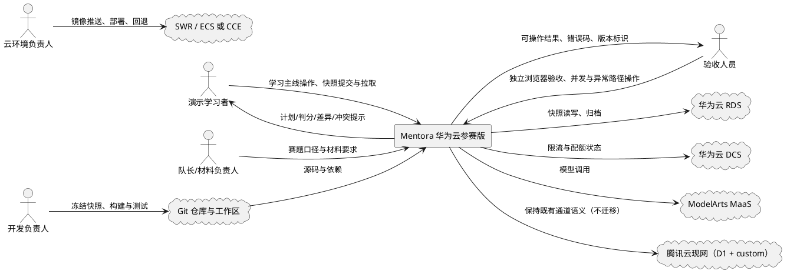
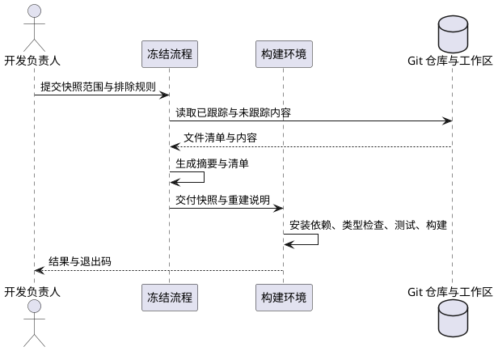
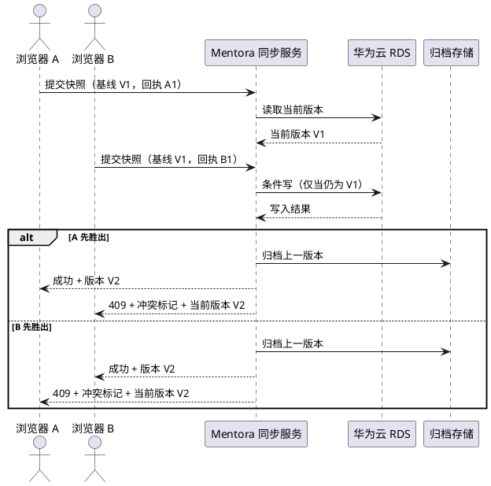
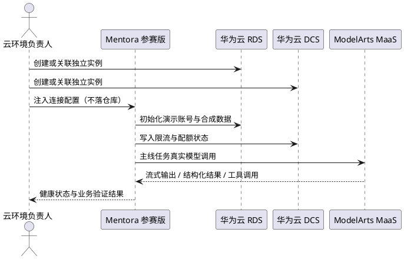
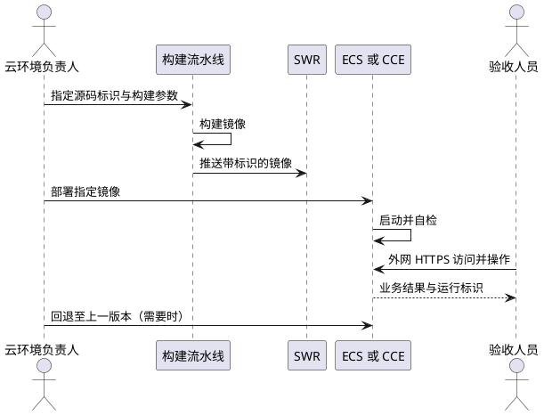
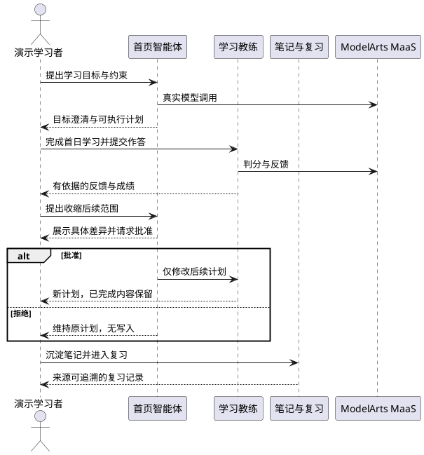
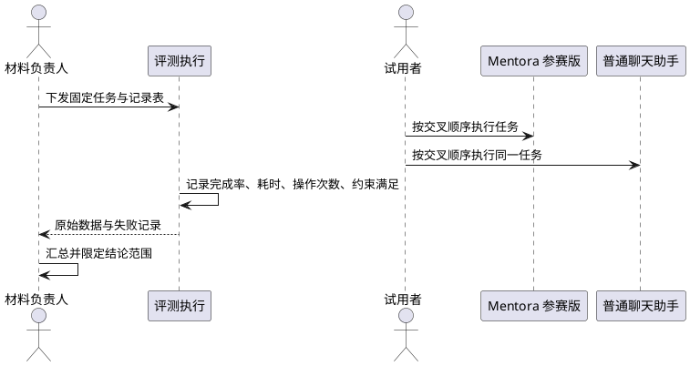
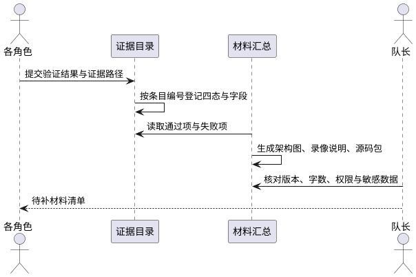
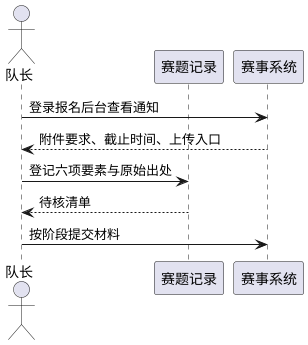
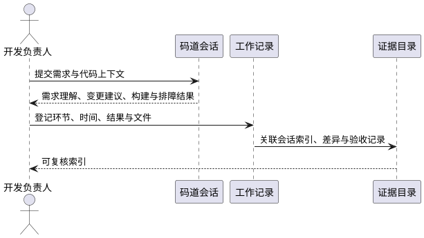

# Mentora 华为 ICT 创新赛赛题一参赛版 需求规格

- 规格标识：`ict_track1_2026_11_20`
- 版本：1.0
- 日期：2026-11-20
- 需求来源：`docs/PRD-HUAWEI-ICT-TRACK1-2026-11-20.md`（v1.0）、`docs/PRD-CODEARTS-ICT-TRACK1-HANDOFF-2026-11-20.md`（v1.1）
- 适用范围：第十一届华为 ICT 大赛中国创新赛赛题一参赛交付，R00–R08 全部验收条目
- 状态口径：全文与 `docs/evidence/ict-track1-2026-11-20/` 统一使用 `PASS / FAIL / BLOCKED / NOT_RUN` 四态

---

# **0. 现状基线与本轮核实结果**

本章记录本轮开工前实际核实的现状，作为后续所有需求的比较基线。基线中的数字、路径、结论均来自 2026-11-20 的实际读取与检查，不引用未经核实的推测。

## **0.1 代码与工作区**

| 项 | 实测值 | 核实方式 |
| --- | --- | --- |
| 分支 | `feature/huawei-cloud-upgrade` | `git rev-parse --abbrev-ref HEAD` |
| HEAD | `facf520` | `git rev-parse --short HEAD` |
| 工作区变更总数 | 507 项 | `git status --porcelain \| wc -l` |
| 其中已跟踪修改 | 141 项 | `git status --porcelain` 中 `M` 计数 |
| 其中未跟踪文件 | 366 项 | 同上 `??` 计数 |
| 未跟踪测试文件 | `src/lib/__tests__/` 下大量 `*.test.ts` | 目录列举 |
| 未跟踪验收脚本 | `scripts/verify-*.mjs` 共 18 个 | 目录列举 |
| 未跟踪证据目录 | `docs/evidence/` 下 `core-acceptance-2026-11-17/` 等 20+ 目录 | 目录列举 |
| 规格目录 | `.codeartsdoer/` 不存在 | 目录探测 |
| 本轮证据目录 | `docs/evidence/ict-track1-2026-11-20/` 不存在 | 目录探测 |

本轮硬性约束：上述 507 项内容属于既有工作，禁止执行清理、重置、覆盖、批量暂存、`git checkout --`、`git stash` 全量操作。任何后续动作必须逐项显式指定路径。

## **0.2 上一轮未提交的初步修改（非本轮码道产出）**

| 位置 | 初步修改内容 | 落盘状态 |
| --- | --- | --- |
| `src/lib/server/db.ts` | 新增 `rdsGetSha`；`rdsPut` 增加 `expectSha` 形参；`dbGet` 增加 `forSnapshotWrite`；`dbPut` 增加 `compareSnapshot` | 已写入工作区，未提交 |
| `src/app/api/sync/route.ts` | 同步写入同时传 `overwriteOnConflict:true` 与 `compareSnapshot:true`；旧块清理移到主行写入之后 | 已写入工作区，未提交 |
| `src/lib/__tests__/sync-conflict-409.test.ts` | 调整源码匹配断言 | 已写入工作区，未提交 |

纪律：以上内容为上一轮 Codex 的初步修改，不得在任何材料中描述为码道本轮生成；本轮如需修正，必须在码道工作记录中单独登记「修正原因 → 变更 → 验证」。

## **0.3 已核实的缺陷（本轮基线判定为 FAIL）**

| 编号 | 缺陷事实 | 核实位置 | 影响 |
| --- | --- | --- | --- |
| D-01 | 主行写入与旧分块清理是两条独立语句，之间无原子边界；主行成功、清理失败时调用方收到失败但数据已被改变 | `db.ts` 无条件写、条件写、首次插入三个分支 | 写入语义不满足「失败即无副作用」 |
| D-02 | 「期望不存在」只判断主行不存在，未判断旧分块行是否存在；历史分块快照会被静默覆盖后再清块 | `db.ts` 首次插入分支 | 首次创建竞争与历史数据保护均失效 |
| D-03 | 快照读取不识别主行的分块头标识，按普通密文直接解密；历史分块快照读回失败 | `db.ts` 读取函数 | 迁移期与历史快照不可读，兼容性不成立 |
| D-04 | 冲突分支未返回当前版本标识，客户端只能得知「冲突」而无法定位当前版本 | `sync/route.ts` 条件写失败分支 | 客户端合并与刷新后找回缺少依据 |
| D-05 | 现有 `sync-conflict-409.test.ts` 以读取源码文本做正则匹配，不访问数据库、不产生并发 | 该测试第 16–17 行读取源码 | 不足以作为并发正确性证据 |

## **0.4 环境事实**

| 项 | 实测值 | 对验收的影响 |
| --- | --- | --- |
| `.env.local` 键数 | 17 个 | — |
| `DATABASE_URL` | 未配置 | 真实华为云 RDS 验证 `BLOCKED` |
| `REDIS_URL`（DCS） | 未配置 | DCS 跨进程验证 `BLOCKED` |
| `MAAS_API_KEY` / `MAAS_BASE_URL` | 未配置 | MaaS 真实调用验证 `BLOCKED` |
| 本机 Docker | 可用（用户已确认） | 可用临时 PostgreSQL 容器做真实 SQL 集成验证，但结论只能标注为「本地等价验证」，不等于华为云 RDS 验证 |
| 依赖版本 | `pg` 8.23.1、`ioredis` 6、`vitest` 5、`next` 16.3.4、`react` 19.2.8 | 集成测试可行性成立 |
| 历史线上版本 | 腾讯云 `fa7816e`，D1 数据通道，custom 模型通道；记录 1718 通过 / 15 跳过 | 仅描述旧环境，不代表当前工作区 |

## **0.5 历史码道成果索引与缺口**

| 历史成果 | 记录位置 | 可出示性 |
| --- | --- | --- |
| 51 条 EARS 需求（HW-* 编号） | `docs/CODEARTS-PRACTICE.md` 第二节 | 文档可考，原件缺失 |
| design.md 7 项决策、tasks.md 45 任务 | 同上；`docs/evidence/INDEX.md` 首节 | 文档可考，原件缺失 |
| 20+ 个 `[codegen-*]`/`[deploy-*]` 提交 | 同上 | git 历史可查 |
| 镜像推送 SWR `mentora/mentora:81f9e91`、67.8MB | 同上；`docs/evidence/INDEX.md` | 记录可考 |
| RDS/DCS 创建→就绪→删除演练、14 份脱敏日志 | `docs/evidence/logs/` | 文件可出示 |
| 13 个真实问题与修复实录 | `docs/CODEARTS-PRACTICE.md` 第四节 | 文档可考 |
| 待补证据 12 项（首次部署、回滚、迁移校验等） | `docs/evidence/INDEX.md` 末节 | 明确标注未完成 |

关键缺口：`docs/CODEARTS-PRACTICE.md` 与 `docs/evidence/INDEX.md` 均引用 `.codeartsdoer/specs/huawei_cloud_upgrade/`，但该目录在当前工作区不存在。历史需求/设计/任务三件套无法出示原件，只能引用文档转述。此缺口记为 `B-06`，不阻断本轮开发，但影响 R02 中「历史记录」部分的可出示强度。

## **0.6 本轮已执行的核实动作（证据）**

1. 完整读取两份 PRD 全文（56 行 / 69 行）。
2. 核实 git 分支、HEAD、变更总数与分类计数。
3. 核实 `.codeartsdoer/` 与 `docs/evidence/ict-track1-2026-11-20/` 均不存在。
4. 核实 `.env.local` 仅 17 个键，且不含 `DATABASE_URL`、`REDIS_URL`、`MAAS_*`。
5. 核实 `db.ts` 快照读写分支、`sync/route.ts` 冲突分支、`sync-conflict-409.test.ts` 的证据形态，确认 D-01 至 D-05 成立。
6. 核实历史码道记录、证据索引、容器与部署资产（`Dockerfile`、`deploy/docker-compose.hw.yml`、`deploy/cce-mentora.yaml`、`deploy/hw/*.ps1`、`scripts/deploy-hw-build.mjs`）。
7. 核实客户端同步能力现状：版本声明、上传回执、冲突态保留、丢回执识别均已存在，但未在华为云 RDS 通道验证。

---

# **1. 组件定位**

## **1.1 核心职责**

本交付单元负责把 Mentora 学习智能体改造为可在华为云独立运行、可核验、可回退的参赛版本，实现学习快照在并发写入下的强一致。

## **1.2 核心输入**

| 输入 | 来源 | 内容概要 |
| --- | --- | --- |
| 学习快照提交 | 演示学习者浏览器、插件端 | 全量学习数据、客户端声明的基线版本、本次上传回执标识 |
| 学习快照拉取 | 同上 | 版本列表查询、指定版本读取、单版本全量读取 |
| 学习主线操作 | 演示学习者 | 目标澄清、计划生成、学习日验收、计划调整请求、审批/拒绝、笔记沉淀、复习 |
| 参赛决策与资料 | 队长 / 材料负责人 | 赛题通知原文、实名信息、合照、字数与格式要求 |
| 冻结与构建指令 | 开发负责人 | 源码快照范围、构建与测试命令、镜像标识 |
| 部署与回滚指令 | 云环境负责人 | 资源清单、镜像地址、部署配置、回退目标版本 |
| 验收测量指令 | 验收人员 | 并发脚本、量化任务脚本、证据采集步骤 |

## **1.3 核心输出**

| 输出 | 目标 | 内容概要 |
| --- | --- | --- |
| 同步响应 | 浏览器 / 插件端 | 成功：服务端版本时间戳与回执确认；冲突：409 + 冲突标记 + 当前版本标识；其余错误码语义不变 |
| 学习主线结果 | 演示学习者 | 计划、学习记录、判分、变更差异、批准的调整结果、笔记与复习记录 |
| 参赛源码快照 | 评审与复现方 | 源码标识、内容清单、摘要、重建步骤 |
| 容器镜像与部署 | 华为云 SWR / ECS / CCE | 镜像摘要、运行标识、回退目标 |
| 公开演示入口 | 评委与验收人员 | HTTPS 地址、演示账号、可用窗口 |
| 证据记录 | 证据目录 | 逐项状态、日期、环境、步骤、预期、实际、证据路径、负责人 |
| 参赛材料 | 赛事提交系统 | 信息表、架构图、演示录像、源码复现说明、量化结果 |

## **1.4 职责边界**

本交付单元不承担以下事项：

1. 小程序端功能扩展、人生伙伴、会员与商业后台的赛题改造；这些维持原有范围，不纳入参赛依赖。
2. 腾讯云生产环境及其用户数据的迁移、复制或停用。
3. 真实付款、外部邮件投递、正式反馈提交等外部副作用操作。
4. 赛事系统的实际上传与提交；提交时点、账号与回执由队长执行。
5. 具体技术实现选型（表结构、索引、SQL 语句、事务隔离级别、连接池参数）；这些由后续设计文档决定，本规格只约束外部可观察行为。
6. 学习效果的因果证明；本规格只要求可测量的任务指标，不要求证明教学法有效性。
7. 历史版本的追溯改写；历史成果按既有记录引用，不重新生成历史证据。

---

# **2. 领域术语**

**参赛版本快照**
: 参赛版本快照是包含当前工作区中运行所需的已跟踪与未跟踪内容、并附带生成命令与摘要的一份可重建源码副本。

**学习快照**
: 学习快照是某个账号在某一时刻的全量学习数据，包括目标、知识条目、书目、学习会话、自定义人物、智能体会话、文件夹与设置。

**快照版本标识**
: 快照版本标识是服务端为每次实际推进的快照写入分配的、可被客户端在下次提交时声明为基线的值。

**归档版本**
: 归档版本是每次快照被覆盖前保存下来的上一份快照，用于回滚与找回，滚动保留最近十份。

**分块快照**
: 分块快照是把超过单条存储上限的快照拆成主行加多个块行保存的形态；读取方必须先识别该形态再按序还原。

**条件写**
: 条件写是仅当存储中的当前值与调用方声明的基线一致时才生效的写入；不一致时写入不生效并报告冲突。

**竞争创建**
: 竞争创建是两个调用方同时认为「该快照尚不存在」而同时创建同一路径快照的情形；只允许一个成功。

**丢回执重试**
: 丢回执重试是服务端已接受写入但客户端未收到成功响应时，客户端凭本次上传回执标识重新提交同一批改动的行为。

**写入通道**
: 写入通道是学习快照所落的具体存储通道，当前包括 D1 与华为云 RDS 两类；同一业务语义在不同通道上必须一致。

**同步水位**
: 同步水位是客户端记录的上次成功同步所对应的服务端版本标识，用于判断云端与本机谁更新。

**演示账号**
: 演示账号是仅用于参赛演示与验收的独立账号，与生产账号及真实用户数据隔离。

**证据条目**
: 证据条目是证据目录中针对一个验收点的一条记录，包含编号、日期、环境、步骤、预期、实际、状态与证据路径。

**MaaS**
: MaaS 是华为云 ModelArts 提供的模型推理服务，承担参赛演示路径上的真实模型调用。

**本地等价验证**
: 本地等价验证是在本机临时数据库实例上完成的、与云端同语义的验证；其结论不得标注为华为云验证通过。

---

# **3. 角色与边界**

## **3.1 核心角色**

演示学习者：以参赛演示身份完成目标、学习、调整、笔记与复习全流程，并执行并发保存、拒绝审批、中断恢复等演示动作。

验收人员：以评委视角独立打开演示入口，按验收清单逐项操作并核对结果，不依赖开发者口述。

开发负责人：冻结参赛版本、实施代码改造、执行构建与测试、登记真实开发证据。

云环境负责人：创建或关联华为云资源、构建推送镜像、部署与回退、记录资源与费用。

队长 / 材料负责人：核实赛题通知、填报信息表、准备合照与演示素材、执行最终提交。

## **3.2 外部系统**

华为云 RDS PostgreSQL：保存演示账号与加密学习快照、归档版本，提供持久化与并发写入能力。

华为云 DCS Redis：保存限流、配额、验证码等短期状态，提供跨进程读取与过期能力。

华为云 ModelArts MaaS：提供主线任务的流式对话、结构化输出与工具调用所需模型能力。

华为云 SWR：保存带源码标识的容器镜像，作为部署与回退的制品来源。

华为云 ECS 或 CCE：承载参赛版本容器与 HTTPS 入口。

华为云 LTS 与 Cloud Eye：接收运行日志与告警，供运维与证据归档。

腾讯云现网环境：保留现有 D1 存储与 custom 模型通道，作为语义不退化对照与既有用户服务，不迁移、不覆盖。

Git 仓库与工作区：提供源码历史、未提交变更与参赛快照的取值来源。

## **3.3 交互上下文**

---

# **4. DFX 约束**

## **4.1 性能**

1. 单次快照提交在请求体不超过 4.2MB 时，服务端处理耗时的第 95 百分位不得超过 2.5 秒。
   - 验证：20 次串行提交，记录每次服务端耗时，取第 95 百分位。
2. 明文不超过 8MB、已处于分块形态的快照，提交与读回各不超过 6 秒。
3. 快照拉取在响应体不超过 4MB 时，端到端耗时不超过 2 秒（不含客户端渲染）。
4. 两路并发提交的冲突判定必须在 3 秒内返回，不得依赖超时兜底。
5. 参赛镜像构建单次耗时应记录实测值，超过 15 分钟视为不满足演示窗口要求。
6. 容器启动到健康检查通过不超过 90 秒。
7. 未取得真实云端测量前，上述云端指标标注「待实测」，不得以本地数据替代云端结论。

## **4.2 可靠性**

1. 同版本并发写入的判定必须确定：20 轮双路并发中，双成功的轮次必须为 0。
2. 写入与旧块清理必须同属一个原子单元：任一环节失败时，主行与块行均保持写入前状态，部分提交次数为 0。
3. 首次创建竞争必须只产生一个成功者；失败方不得留下任何行。
4. 归档失败不得阻断本次写入，但必须产生一条可检索的记录，且不得覆盖已存在的同版本归档。
5. 冲突失败后，存储中的快照内容、版本标识与归档集合必须与失败前逐字节一致。
6. 容器重启后，演示账号的学习快照必须可读，恢复时间不超过 5 分钟。
7. 任一通道不可用时，接口必须返回明确错误，不得降级为静默覆盖或返回空数据。

## **4.3 安全性**

1. 学习快照必须以密文形式落存储；快照中的模型密钥字段在任何通道上均不得上云。
2. 所有云凭据仅通过部署环境注入，禁止出现在源码、镜像、证据文档与截图中。
3. 演示账号必须与生产账号、真实用户数据隔离；跨账户读取必须被拒绝。
4. 日志与证据不得包含明文快照、完整键路径中的账号标识、令牌、连接串。
5. 失败的登录、越权访问与冲突写入必须可在日志中定位，且不泄露内容。

## **4.4 可维护性**

1. 每次同步写入与冲突必须产生一条结构化记录，至少包含事件类型、路径摘要、结果分类、耗时；不得包含快照内容。
2. 镜像标识必须与源码标识一一对应，部署后可查询运行标识。
3. 每个验收条目必须有唯一编号与证据路径，证据可被第三人按路径复核。
4. 证据目录必须保留失败与未执行条目，禁止只保留成功项。

## **4.5 兼容性**

1. D1 通道的并发、归档、普通写入行为在改造后不得退化，须有行为级回归。
2. 未声明基线版本的旧客户端必须仍可写入，且其行为不得被描述为具备并发保护。
3. 历史分块快照必须可完整读回；缺块时必须报告不完整，不得返回空内容或部分内容。
4. 既有接口错误码语义（401 / 403 / 409 / 413 / 429 / 503）不得改变。
5. 非快照类读写（普通对象、归档文件、存在性写入、删除）语义不得改变。
6. 参赛镜像必须保留可回退的上一版本，回退不得依赖重新构建。

---

# **5. 核心能力**

说明：每条规则采用 EARS 句式（英文触发词 + 中文变量），并标注优先级与验收条件。`[P0]` 为参赛发布门槛，`[P1]` 为增强项。

## **5.1 参赛版本冻结与可重建（R01）**

### **5.1.1 业务规则**

1. **REQ-01-01 [P0] 唯一源码标识**：The 参赛版本快照 shall 具备唯一源码标识，且该标识可在构建产物、镜像标签与演示材料中互相校验。
   - 验收条件：取快照生成镜像并部署 → 通过运行标识查询得到的源码标识与快照登记值一致。
2. **REQ-01-02 [P0] 内容范围完整**：The 参赛版本快照 shall 包含当前工作区中运行所必需的已跟踪文件与未跟踪文件，并排除依赖目录、构建产物、日志、密钥与无关临时文件。
   - 验收条件：在干净目录按快照重建 → 类型检查、相关测试、构建均可执行；依赖目录、日志、密钥不在快照清单中。
3. **REQ-01-03 [P0] 可重建**：When 在干净环境按快照说明执行安装、类型检查、测试与构建，the 参赛版 shall 全部完成并记录命令、退出码与结果。
   - 验收条件：干净环境执行四步 → 退出码为 0；如有既有失败或跳过，逐条列明原因且不计入本次通过数。
4. **REQ-01-04 [P0] 禁用旧提交号冒充参赛版本**：The 参赛版 shall 将「提交号」与「包含未提交变更的参赛快照」明确区分，禁止以旧提交号指代含未提交修改的版本。
   - 验收条件：检查材料中的版本表述 → 每个版本引用同时给出提交号与快照摘要，两者不同时明确标注。
5. **REQ-01-05 [P0] 保留既有工作区**：The 参赛版 shall 保留当前工作区全部 507 项变更，禁止执行清理、重置、覆盖或批量暂存。
   - 验收条件：冻结前后比对 `git status` → 变更条目集合不减少，未跟踪文件不丢失。
6. **REQ-01-06 [P1] 快照摘要**：The 参赛版 shall 记录快照的文件数、总大小、摘要值与生成命令。
   - 验收条件：按记录重新生成快照 → 文件数与摘要值可复现。

### **5.1.2 交互流程**

### **5.1.3 异常场景**

1. **密钥或凭据进入快照**
   - 触发条件：清单扫描命中环境文件、令牌或连接串。
   - 系统行为：阻断快照生成，剔除命中文件并重新生成摘要，登记一条剔除记录。
   - 用户感知：冻结流程返回失败并列出命中路径；不得仅打印警告后继续。
2. **未跟踪文件遗漏导致构建失败**
   - 触发条件：干净环境重建时出现模块缺失或类型错误。
   - 系统行为：回查清单与工作区差异，补齐运行必需文件，重新生成快照。
   - 用户感知：重建报告指出缺失文件与所属目录。
3. **既有测试失败**
   - 触发条件：干净环境测试出现非本次引入的失败。
   - 系统行为：单独登记失败用例、原因判断与归属版本，不修改其结论。
   - 用户感知：报告中失败与通过分列，禁止合并统计。

## **5.2 学习快照云同步一致性（R02 / R04）**

### **5.2.1 业务规则**

1. **REQ-04-01 [P0] 同版本并发仅一个成功**：When 两个独立会话基于同一快照版本并发提交，the 同步服务 shall 仅接受其中一个提交，并向另一个返回 409、冲突标记与当前版本标识。
   - 验收条件：两路并发提交同一基线 → 成功响应恰好 1 个，409 响应恰好 1 个，且 409 响应体含当前版本标识；20 轮重复均成立。
2. **REQ-04-02 [P0] 冲突无副作用**：If 条件写判定失败，the 同步服务 shall 保持快照内容、版本标识与归档集合与失败前一致。
   - 验收条件：冲突后读取快照 → 内容哈希与失败前相同；归档数量不变；不得出现新增块行或残留标记行。
3. **REQ-04-03 [P0] 首次创建竞争**：When 两路并发首次创建同一账号快照，the 同步服务 shall 仅允许一路创建成功。
   - 验收条件：两路并发首次写入 → 成功 1 个、冲突 1 个；存储中该路径只有一份内容，无重复块行。
4. **REQ-04-04 [P0] 残留分块视为已存在**：While 目标路径存在任何历史分块行而主行缺失，the 同步服务 shall 将该路径判定为已存在，禁止按首次创建处理。
   - 验收条件：构造「只有块行、无主行」的路径后发起首次写入 → 返回冲突，块行内容不被删除或改写。
5. **REQ-04-05 [P0] 写入与清理原子**：The 同步服务 shall 将主行写入与旧分块清理纳入同一原子单元，任一环节失败时全部不生效。
   - 验收条件：注入清理失败 → 写入返回失败，主行与块行均保持原状；注入主行失败 → 块行保持原状；两种情形下均无部分提交。
6. **REQ-04-06 [P0] 历史分块兼容读取**：When 读取主行为分块形态的快照，the 同步服务 shall 识别分块数量并按序还原完整内容。
   - 验收条件：构造 3 块快照 → 读回内容与写入前逐字节一致；缺少中间块 → 返回「快照不完整」错误，不得返回部分内容或空内容。
7. **REQ-04-07 [P0] 版本标识同源**：The 同步服务 shall 使用与条件写完全相同的口径生成读取返回的版本标识，使客户端声明的基线可直接用于下次条件写。
   - 验收条件：读取得到版本标识后原样作为基线提交 → 在无并发改动时提交成功；篡改任一字节的基线 → 提交返回冲突。
8. **REQ-04-08 [P0] 归档只属于推进者**：While 某次写入实际推进了版本，the 同步服务 shall 归档其替换的上一版本；未推进版本的写入不得归档。
   - 验收条件：成功覆盖写入一次 → 归档新增 1 份且内容等于写入前快照；冲突写入与相同内容重复提交 → 归档数量不变。
9. **REQ-04-09 [P0] 归档不重复不越界**：The 同步服务 shall 对已存在的同版本归档跳过写入，并将归档总数维持在最近 10 份。
   - 验收条件：连续写入 12 次 → 归档数为 10；重复时间戳写入 → 不产生重复条目。
10. **REQ-04-10 [P0] 相同内容不推进版本**：When 提交内容与云端当前快照等价，the 同步服务 shall 返回原版本标识且不写入、不归档。
    - 验收条件：原样重复提交 → 响应成功且版本标识与之前相同；存储内容哈希不变；归档数不变。
11. **REQ-04-11 [P0] 成功响应语义**：When 写入成功，the 同步服务 shall 返回服务端生成的版本标识与成功标记，且该标识严格大于此前版本。
    - 验收条件：连续两次成功写入 → 两个版本标识严格递增；客户端以返回值更新同步水位后刷新 → 不触发回拉覆盖。
12. **REQ-04-12 [P0] 冲突响应语义**：When 返回 409，the 同步服务 shall 在响应中同时给出冲突标记与当前版本标识，供客户端展示与合并。
    - 验收条件：制造冲突 → 响应体含冲突标记与当前版本标识；该标识等于冲突时存储中的实际版本。
13. **REQ-04-13 [P0] 客户端丢回执可恢复**：If 客户端未收到成功回执但服务端已接受写入，the 参赛版 shall 允许客户端凭本次上传回执标识重新提交，并保证不重复推进版本或丢失本机改动。
    - 保留既有同步语义：同一账户下，初次写入成功但回执丢失，客户端以**旧版本基线**原样重发**相同内容**时，服务端按内容等价判定为幂等，返回云端**当前版本**，版本标识与归档条目均不增加。
    - 旧版本基线提交**不同内容**时仍返回 409，不得因回执匹配而隐式放行或覆盖。
    - 验收条件：延迟首个成功响应后，以旧基线原样重发 → 200 且返回当前版本，版本号、存储哈希、归档数均不变；以旧基线提交不同内容 → 409 且云端不变；继续编辑并刷新 → 本机改动保留，云端可读回两批改动，归档无重复条目。
    - 同一组用例须在 D1 与 RDS 两个通道各执行一次，结论分别记录。
14. **REQ-04-14 [P0] 弱网重试不双写**：While 网络超时触发客户端重试，the 同步服务 shall 通过版本条件保证重试不产生两份不同内容。
    - 验收条件：注入首包超时后重试 → 最终存储只有一份内容，且与客户端最终状态一致。
15. **REQ-04-15 [P0] 跨账户隔离**：If 请求声明的账号与已认证账号不一致，the 同步服务 shall 拒绝请求且不暴露对方快照内容。
    - 验收条件：使用 A 账号凭据请求 B 账号路径 → 返回 403 或 404，响应不含 B 的任何数据。
16. **REQ-04-16 [P0] 大快照并发一致**：When 快照处于分块形态时发生并发写入，the 同步服务 shall 维持与普通快照相同的「仅一成功」语义，且胜出方可完整读回。
    - 验收条件：构造超过单条上限的快照后双路并发 → 成功 1、冲突 1；读回内容完整且哈希匹配。
17. **REQ-04-17 [P0] D1 语义不退化**：The 参赛版 shall 在 D1 通道保留既有的并发判定、归档、相同内容幂等、丢回执原样重发与普通写入行为。
    - 验收条件：D1 通道执行并发与归档回归 → 结果与改造前记录一致；REQ-04-13 的丢回执同组用例在 D1 与 RDS 上均通过；新增行为级用例全部通过。
18. **REQ-04-18 [P0] 非快照调用不受影响**：The 参赛版 shall 保持普通对象读写、存在性写入、删除、迁移与初始化的既有语义。
    - 验收条件：对非快照路径执行读、写、存在性写、删除 → 行为与改造前一致；不产生额外块行或归档。
19. **REQ-04-19 [P0] 行为级验收**：The 验收证据 shall 来自真实数据库行为或接口响应与最终存储状态的比对，禁止以源码文本匹配作为并发正确性证据。
    - 验收条件：审查并发测试 → 测试实际建立连接、执行写入并断言响应与存储状态；源码匹配类断言不计入并发结论。
20. **REQ-04-20 [P1] 失败可诊断**：When 条件写失败，the 同步服务 shall 记录路径摘要、结果分类与耗时，且不记录快照内容。
    - 验收条件：触发冲突后检索日志 → 可定位该次失败；日志中无明文快照与完整账号标识。
21. **REQ-04-21 [P0] 冲突后本机可找回**：When 客户端收到 409，the 参赛版 shall 保留本机改动、阻止其以旧基线覆盖云端，并提供刷新、合并与导出本机备份的入口。
    - 验收条件：冲突后刷新页面 → 本机改动仍可见；导出备份可得到包含本机改动的文件；再次提交带已过期基线 → 仍返回 409 而非覆盖。

### **5.2.2 交互流程**

### **5.2.3 异常场景**

1. **同版本并发冲突**
   - 触发条件：两会话基于同一版本同时提交。
   - 系统行为：条件写只允许一个成功；失败方不产生任何写入与归档。
   - 用户感知：失败方收到 409、冲突标记与当前版本标识；界面进入冲突态并保留本机改动。
2. **首次创建竞争**
   - 触发条件：两会话同时认为快照不存在。
   - 系统行为：仅一个创建成功；失败方不写入、不清块。
   - 用户感知：失败方收到 409，刷新后可读取胜出方内容。
3. **历史分块缺块**
   - 触发条件：主行声明的块数与实际块行数不一致。
   - 系统行为：拒绝还原，报告快照不完整；不得回退为返回空或部分内容。
   - 用户感知：读取失败提示「云端快照不完整」，并提供历史版本入口。
4. **旧块清理失败**
   - 触发条件：原子单元中的清理环节失败。
   - 系统行为：整个写入不生效，主行维持旧值。
   - 用户感知：写入失败提示；重试后结果一致，不出现「报失败但数据已变」。
5. **归档失败**
   - 触发条件：归档写入异常。
   - 系统行为：不阻断本次写入；记录归档失败事件；不留半份归档条目。
   - 用户感知：写入仍成功；历史版本列表中不出现残缺条目。
6. **上传回执丢失**
   - 触发条件：服务端成功但客户端未收到响应。
   - 系统行为：下次提交携带同一回执标识；内容与云端当前快照等价时返回当前版本，不推进版本、不新增归档；内容不同时按旧基线判定返回 409，不隐式放行。
   - 用户感知：刷新后本机改动仍在，云端最终一致，无重复归档；不同内容的旧基线提交得到明确冲突提示。
7. **超大请求**
   - 触发条件：请求体或解压后体积超过上限。
   - 系统行为：拒绝并保持存储不变。
   - 用户感知：413 与明确的精简提示。
8. **通道不可用**
   - 触发条件：RDS 连接失败或超时。
   - 系统行为：返回 503，不降级为覆盖写，不返回空快照。
   - 用户感知：503 提示与重试入口；本机改动保留。

## **5.3 华为云资源与模型业务链（R03）**

### **5.3.1 业务规则**

1. **REQ-03-01 [P0] 资源隔离**：The 参赛版 shall 使用已证实独立的 RDS、DCS 与计算资源，并使用独立演示账号与合成数据。
   - 验收条件：核对资源清单与账号 → 资源不属于其他参赛者或生产环境；演示账号不属于真实用户。
2. **REQ-03-02 [P0] RDS 持久化**：When 演示账号写入学习数据并重新登录，the 参赛版 shall 从 RDS 读回同一份数据。
   - 验收条件：写入目标与笔记 → 退出并以同账号重新登录 → 读回内容一致；重启应用进程后仍可读回。
3. **REQ-03-03 [P0] DCS 跨进程状态**：The 参赛版 shall 使限流与配额状态可跨进程读取，并按设定时间过期。
   - 验收条件：进程 A 触发限流后由进程 B 读取 → 状态一致；到达过期时间后状态清除。
4. **REQ-03-04 [P0] MaaS 真实调用**：When 演示主线调用模型，the 参赛版 shall 通过 MaaS 完成真实调用，并支持流式输出、结构化结果与首页工具调用。
   - 验收条件：主线任务实际产生模型请求 → 记录模型标识、请求时间、响应片段与结构化字段；流式内容逐步到达；工具调用可观察。
5. **REQ-03-05 [P0] 健康检查不作业务证据**：The 验收记录 shall 仅将健康检查作为配置核对，业务验证须由真实读写与模型调用构成。
   - 验收条件：审查证据 → 健康检查结果与业务验证结果分列，不得以健康 200 代替业务通过。
6. **REQ-03-06 [P0] 资源与费用记录**：The 证据目录 shall 记录资源创建或关联、验证操作、耗时与费用；未知项标注「未知」。
   - 验收条件：核对资源证据 → 每项含资源类型、区域、规格、角色、验证时间与结论；费用字段无空白。
7. **REQ-03-07 [P1] 资源回收说明**：The 参赛版 shall 提供资源的停用或删除步骤，支持按需开关以控制费用。
   - 验收条件：按说明执行停用 → 资源状态变更可验证；停止后不再产生业务调用。

### **5.3.2 交互流程**

### **5.3.3 异常场景**

1. **缺少云凭据**
   - 触发条件：环境中无 RDS、DCS 或 MaaS 配置。
   - 系统行为：相关能力标记 `BLOCKED`；继续完成不依赖凭据的开发与本地等价验证。
   - 用户感知：验收报告明确列出阻塞项与解除条件，不将未验证项标为通过。
2. **模型调用失败或超时**
   - 触发条件：MaaS 返回错误、限流或超时。
   - 系统行为：记录模型标识、错误类别与耗时；主线降级为可重试提示，不伪造回答。
   - 用户感知：明确的失败提示与重试入口。
3. **RDS 连接中断**
   - 触发条件：网络或实例不可达。
   - 系统行为：返回 503；不切换为静默覆盖；不写入本地伪成功。
   - 用户感知：同步失败提示与本机改动保留。
4. **DCS 状态丢失**
   - 触发条件：实例重启或键过期。
   - 系统行为：按应用层权威判断重新计算状态；不因缓存缺失放行超额请求。
   - 用户感知：无异常感知或收到正常的限流提示。

## **5.4 部署与回退（R05）**

### **5.4.1 业务规则**

1. **REQ-05-01 [P0] 镜像可追溯**：When 构建参赛镜像，the 参赛版 shall 使镜像标签与源码标识一致，并记录镜像摘要。
   - 验收条件：查询镜像标签与摘要 → 与快照登记的源码标识一致。
2. **REQ-05-02 [P0] 推送与部署**：The 参赛版 shall 推送镜像至 SWR，并部署至可用的 ECS 或 CCE 环境。
   - 验收条件：推送后 SWR 可拉取；部署后实例运行且健康检查通过。
3. **REQ-05-03 [P0] 公网 HTTPS 入口**：When 从外网独立浏览器访问，the 参赛版 shall 通过 HTTPS 打开并完成真实业务操作。
   - 验收条件：非内网环境访问 → 页面可打开；完成一次目标创建与快照保存；页面可见运行标识。
4. **REQ-05-04 [P0] 运行标识一致**：The 在线入口 shall 展示与镜像一致的运行标识，供验收人员核对。
   - 验收条件：比对页面运行标识与镜像标签 → 一致。
5. **REQ-05-05 [P0] 重启后数据可读**：When 容器重启，the 参赛版 shall 从 RDS 读回演示账号数据。
   - 验收条件：重启容器 → 重新登录后目标、笔记、复习记录完整。
6. **REQ-05-06 [P0] 可回退**：When 需要回退，the 参赛版 shall 可切换至上一版本镜像并恢复可用，记录实际耗时。
   - 验收条件：执行回退 → 入口恢复可用，运行标识为上一版本；记录耗时与验证结果。
7. **REQ-05-07 [P0] 凭据安全注入**：The 参赛版 shall 仅通过部署环境提供凭据，禁止写入仓库、镜像或证据文档。
   - 验收条件：扫描仓库与镜像 → 无凭据；证据文档中连接串与密钥为脱敏形态。
8. **REQ-05-08 [P1] 有限权限演示账号**：The 参赛版 shall 提供仅能访问演示数据的账号，并准备备用录像。
   - 验收条件：使用演示账号登录 → 只能看到演示数据；备用录像可离线播放。
9. **REQ-05-09 [P1] 可用窗口与成本**：The 证据目录 shall 记录演示入口的实际可用窗口与云资源成本。
   - 验收条件：核对记录 → 含起止时间、计费方式与实际或估算金额，未知项标注未知。

### **5.4.2 交互流程**

### **5.4.3 异常场景**

1. **镜像构建失败**
   - 触发条件：依赖安装或构建步骤失败。
   - 系统行为：保留失败日志与退出码；不推送不完整镜像。
   - 用户感知：报告指出失败步骤与原因分类。
2. **推送认证失败**
   - 触发条件：SWR 登录或权限不足。
   - 系统行为：终止推送；记录非敏感错误摘要。
   - 用户感知：明确提示权限或登录问题，不显示凭据。
3. **部署后健康检查不通过**
   - 触发条件：容器启动失败或配置缺失。
   - 系统行为：保持上一版本可用；不将新版本标记为已部署。
   - 用户感知：部署报告为失败，入口仍指向可用版本。
4. **回退后数据不兼容**
   - 触发条件：新版本写入了旧版本无法读取的数据形态。
   - 系统行为：回退前检查数据兼容性；不兼容时阻止回退并报告。
   - 用户感知：明确提示不兼容原因与可选处置。

## **5.5 学习主线与异常路径（R06）**

### **5.5.1 业务规则**

1. **REQ-06-01 [P0] 主线完整**：When 演示学习者按脚本操作，the 参赛版 shall 依次完成目标澄清、计划生成、首日学习与验收、计划调整、差异查看与批准、笔记沉淀与复习。
   - 验收条件：同一演示账号完整走通 → 每步产生可查看结果，且下一步可引用上一步状态。
2. **REQ-06-02 [P0] 审批前不变**：While 计划调整处于待审批状态，the 参赛版 shall 不修改目标、计划与已完成记录。
   - 验收条件：提交调整请求后不批准 → 读取目标与计划，内容与调整前一致。
3. **REQ-06-03 [P0] 批准后范围受限**：When 学习者批准调整，the 参赛版 shall 仅修改批准范围内的后续计划，保留已完成课程与成绩。
   - 验收条件：批准后查看 → 后续计划按差异变化；已完成学习日与判分结果仍可查看。
4. **REQ-06-04 [P0] 拒绝审批**：If 学习者拒绝调整，the 参赛版 shall 不写入任何变更，并保留原计划。
   - 验收条件：拒绝后读取 → 计划未变；界面提示已拒绝；无新增归档。
5. **REQ-06-05 [P0] 中断可恢复**：When 生成过程中刷新、关闭或重新进入，the 参赛版 shall 恢复同一任务与已有进度。
   - 验收条件：生成中刷新 → 回到同一任务并可继续；已产生内容不丢失。
6. **REQ-06-06 [P0] 真实模型与工具**：The 参赛版 shall 在演示路径上使用真实模型调用与真实工具执行，禁止使用预制回答或静态样例冒充。
   - 验收条件：核对请求记录 → 存在实际模型请求与工具调用结果；回答内容与工具数据一致。
7. **REQ-06-07 [P0] 前后状态证据**：The 验收记录 shall 保存关键写入前后的状态证据与录屏。
   - 验收条件：检查证据 → 审批、拒绝、调整、笔记、复习各有关键状态截图或录像与对应数据。
8. **REQ-06-08 [P1] 备用演示路径**：The 参赛版 shall 提供备用演示路径与时长控制，保证单次演示可在窗口内完成。
   - 验收条件：按备用脚本演练 → 全程无阻断，时长在预定窗口内。

### **5.5.2 交互流程**

### **5.5.3 异常场景**

1. **模型响应中断**
   - 触发条件：流式输出中断或超时。
   - 系统行为：保留已生成内容，标记未完成，提供继续入口。
   - 用户感知：可继续同一问题，不重复已生成部分。
2. **审批时目标已被他端修改**
   - 触发条件：展示差异后另一会话修改了目标。
   - 系统行为：拒绝覆盖，提示重新读取最新内容。
   - 用户感知：明确提示「内容已变化」，本次未写入。
3. **写入失败**
   - 触发条件：保存调整或笔记时存储不可用。
   - 系统行为：不标记成功，保留草稿，提供重试。
   - 用户感知：失败提示与草稿保留。
4. **演示中断**
   - 触发条件：演示过程中浏览器崩溃或网络断开。
   - 系统行为：重新进入后从云端与本机恢复。
   - 用户感知：进度可恢复，已保存内容不丢。

## **5.6 量化评测（R07）**

### **5.6.1 业务规则**

1. **REQ-07-01 [P1] 固定任务对照**：The 量化评测 shall 使用同一固定任务，对比普通聊天助手与 Mentora 的表现。
   - 验收条件：核对任务脚本 → 两侧使用同一任务描述、同一输入材料与同一评判口径。
2. **REQ-07-02 [P1] 指标定义**：The 量化评测 shall 测量任务完成率、从提交目标到得到可执行并保存计划的耗时、实际操作次数与计划约束满足情况。
   - 验收条件：核对记录 → 每个指标有定义、测量方法与原始数据。
3. **REQ-07-03 [P1] 样本与顺序**：The 量化评测 shall 建议至少 5 名试用者，采用交叉顺序，并记录样本特征与失败情况。
   - 验收条件：核对样本表 → 人数、顺序、任务版本与失败原因齐全；不足 5 人时如实标注。
4. **REQ-07-04 [P1] 工程量化**：The 量化评测 shall 独立记录工程通过数与请求耗时。
   - 验收条件：核对记录 → 通过、失败、跳过数分列，耗时含测量环境与样本量。
5. **REQ-07-05 [P1] 结论限定**：The 量化材料 shall 将结论限定在样本范围内，禁止虚构学习效果或性能提升。
   - 验收条件：审查结论 → 每条结论可回溯到样本与测量记录，无超出样本的推断。

### **5.6.2 交互流程**

### **5.6.3 异常场景**

1. **试用者不足**
   - 触发条件：可参与人数少于 5 名。
   - 系统行为：按实际人数记录，标注样本不足。
   - 用户感知：结论注明样本限制，不作普遍性推断。
2. **任务中途放弃**
   - 触发条件：试用者未完成任务。
   - 系统行为：记为未完成，保留放弃原因。
   - 用户感知：完成率统计包含未完成样本。
3. **两侧条件不一致**
   - 触发条件：模型、材料或评判口径不同。
   - 系统行为：判定该轮无效并重做，不计入统计。
   - 用户感知：记录无效轮次与原因。

## **5.7 赛题材料与证据目录（R08）**

### **5.7.1 业务规则**

1. **REQ-08-01 [P0] 固定证据目录**：The 参赛版 shall 在 `docs/evidence/ict-track1-2026-11-20/` 下建立证据目录，并包含版本清单、历史证据索引、码道会话索引、代码差异、构建与测试结果、云资源与模型验证、部署与回退、演示材料、信息表与待补材料。
   - 验收条件：目录检查 → 上述类别均有对应文件或子目录，无缺失类别。
2. **REQ-08-02 [P0] 四态记录**：The 证据条目 shall 使用 `PASS / FAIL / BLOCKED / NOT_RUN` 四态之一，并包含日期、环境、步骤、预期、实际、证据路径与负责人。
   - 验收条件：抽查条目 → 七个字段齐全，状态取自四态集合。
3. **REQ-08-03 [P0] 原样保留失败**：The 证据目录 shall 保留所有失败与未执行条目，禁止删除、覆盖或只保留成功项。
   - 验收条件：核对历史记录 → 失败项仍在且标注原因；无被清理痕迹。
4. **REQ-08-04 [P0] 材料版本一致**：The 参赛材料 shall 与验收通过的版本一致，包含架构图、演示录像、可重建源码包与必要说明。
   - 验收条件：比对材料中的版本标识 → 与证据目录登记版本一致。
5. **REQ-08-05 [P0] 信息表合规**：The 信息表 shall 保留模板结构与字数限制；缺失的实名信息、队伍信息与合照留空。
   - 验收条件：核对信息表 → 字数未超限；缺失项为空而非编造。
6. **REQ-08-06 [P0] 历史与本轮分列**：The 技术实践材料 shall 明确区分历史码道工作与本轮工作，并各自注明版本与日期。
   - 验收条件：审查材料 → 每项工作有归属标记；上一轮未提交修改不得标为本轮码道产出。
7. **REQ-08-07 [P0] 提交前检查**：The 参赛材料 shall 在上传前检查文件名、链接访问权限、个人数据与凭据。
   - 验收条件：按清单检查 → 无失效链接、无敏感数据、命名符合要求。
8. **REQ-08-08 [P1] 引用可复核**：The 参赛材料 shall 使第三方引用与许可说明可被复核。
   - 验收条件：抽查引用 → 有来源与许可说明；无未标注的第三方素材。

### **5.7.2 交互流程**

### **5.7.3 异常场景**

1. **证据缺失**
   - 触发条件：某验收点无证据路径。
   - 系统行为：登记为 `NOT_RUN` 并注明缺失原因。
   - 用户感知：报告列出待补清单，不视为通过。
2. **版本不一致**
   - 触发条件：材料版本与验收版本不同。
   - 系统行为：以验收版本为准重生成材料，保留旧件并标注作废。
   - 用户感知：材料清单显示替换记录。
3. **材料含敏感信息**
   - 触发条件：扫描命中凭据、个人联系方式或真实用户数据。
   - 系统行为：阻断上传，脱敏后重新生成。
   - 用户感知：列出命中项与处置结果。

## **5.8 赛题口径与提交条件（R00）**

### **5.8.1 业务规则**

1. **REQ-00-01 [P0] 附件要求完备**：The 赛题记录 shall 为每个强制附件记录格式、命名、大小、提交入口、所处阶段与截止时间。
   - 验收条件：核对记录 → 每个附件六项齐全；缺项标注「待核」。
2. **REQ-00-02 [P0] 原始出处**：The 赛题记录 shall 为「Demo 是否初赛必交」「开源条件」「公网地址最迟提供阶段」提供原始出处。
   - 验收条件：抽查结论 → 每条附原始截图或链接与核验日期。
3. **REQ-00-03 [P0] 禁止推测**：If 官方信息未取得，the 赛题记录 shall 标注「待核」，不得以经验推断替代。
   - 验收条件：审查记录 → 未核验项均有待核标记，无确定性表述。
4. **REQ-00-04 [P1] 可追溯**：The 赛题记录 shall 保留截图、链接与核验日期，供提交前复核。
   - 验收条件：核对记录 → 每项含核验日期与出处。

### **5.8.2 交互流程**

### **5.8.3 异常场景**

1. **后台通知不可访问**
   - 触发条件：账号权限或系统维护导致无法查看。
   - 系统行为：登记 `BLOCKED`，保留已尝试的时间与现象。
   - 用户感知：阻塞项与解除条件明确列出。
2. **要求发生变更**
   - 触发条件：官方通知更新。
   - 系统行为：以最新通知为准更新记录，保留历史版本与变更时间。
   - 用户感知：记录显示变更差异。

---

## **5.9 码道工作过程记录（R02）**

### **5.9.1 业务规则**

1. **REQ-02-01 [P0] 五环节留痕**：The 参赛版 shall 为需求理解、代码生成、项目构建、问题修复、部署上线五个环节分别保留记录，每条记录包含时间、执行内容、结果与对应文件或提交。
   - 验收条件：审查记录 → 五个环节均有条目；部署环节受阻时须登记 `BLOCKED` 与已完成部分，不得留空或合并到其他环节。
2. **REQ-02-02 [P0] 关键改动可出示**：The 参赛版 shall 为至少一项关键改动保留实际码道会话索引、代码差异与验收结果，三者可互相定位。
   - 验收条件：按会话索引定位 → 可找到对应差异文件与验收记录；差异内容与验收对象一致。
3. **REQ-02-03 [P0] 只记实际执行**：The 工作记录 shall 只记录实际执行的动作与结果，禁止将上一轮未提交修改描述为本轮码道产出。
   - 验收条件：核对记录与提交时间线 → 上一轮 Codex 修改单独标注来源，本轮产出有独立时间与证据。
4. **REQ-02-04 [P0] 历史注版本**：The 工作记录 shall 为历史码道成果注明所属版本与日期，并将其与本轮成果分列。
   - 验收条件：抽查历史条目 → 含版本标识与日期；与本轮条目在结构上可区分。
5. **REQ-02-05 [P1] 排障过程保留**：The 工作记录 shall 保留问题定位过程，包括失败尝试、根因判断、修复内容与复测结果。
   - 验收条件：抽查一个问题 → 可看到至少一次失败尝试与最终复测通过记录。

### **5.9.2 交互流程**

### **5.9.3 异常场景**

1. **会话记录缺失**
   - 触发条件：关键改动无法关联到实际会话。
   - 系统行为：该改动不得标记为码道产出；补录可获得的部分并标注缺失。
   - 用户感知：记录中显示「会话索引缺失」，影响范围明确。
2. **部署环节受阻**
   - 触发条件：无云资源权限或凭据。
   - 系统行为：登记 `BLOCKED`，保留构建、镜像准备与排障记录。
   - 用户感知：五环节记录中部署项为阻塞，其余项不受影响。
3. **修改与验收不对应**
   - 触发条件：差异文件与验收对象不一致。
   - 系统行为：重新建立关联或补充验收，不修改历史记录。
   - 用户感知：索引中标注不一致并给出修正记录。

---

# **6. 数据约束**

## **6.1 学习快照**

1. **goals**：学习目标集合，可为空数组；每个目标必须有稳定标识与标题。
2. **knowledge**：知识条目集合，可为空数组；每条必须有稳定标识与正文。
3. **books**：书目集合，可为空数组。
4. **sessions**：学习会话集合，可为空数组。
5. **customPersonas**：自定义人物集合，可为空数组。
6. **agentSessions**：智能体会话集合，可为空数组；每条包含消息列表。
7. **folders**：文件夹名称集合，最多 10000 项；缺省时保留云端现有值。
8. **settings**：设置对象；其中模型密钥字段在任何通道上必须为空字符串，不得上云。
9. **快照体积**：单次提交的请求体上限 4.2MB；解压后上限 64MB；超过上限必须拒绝且不写入。

## **6.2 快照版本与归档**

1. **版本标识**：每个实际推进的版本必须有非空标识；同一路径的标识严格递增。
2. **基线声明**：客户端声明的基线必须为字符串或空值；空值表示「期望不存在」。
3. **归档条目**：每条归档必须对应一个被替换版本的标识与内容；同一标识只允许一份。
4. **归档数量**：单账号保留最近 10 份；超出的按最旧优先删除。
5. **内容等价**：提交内容与当前快照等价时不得产生新版本、新归档或新块行。
6. **残留块行**：任何路径存在块行即视为该路径已被占用；块行不得在未成功写入的情况下被删除。

## **6.3 证据条目**

1. **编号**：必须唯一，且可映射到 R00–R08 中至少一个条目。
2. **状态**：取值只能是 `PASS`、`FAIL`、`BLOCKED`、`NOT_RUN`。
3. **日期**：必须为实际执行日期，不得填写计划日期。
4. **环境**：必须区分本地、本地等价验证、腾讯云现网、华为云参赛环境。
5. **版本**：必须记录对应的源码标识或部署标识。
6. **证据路径**：必须为仓库内可访问的相对路径或可复核的外部链接。
7. **失败与未执行**：必须保留，不得改写为通过。

## **6.4 资源与模型验证记录**

1. **资源类型**：必须标明数据库、缓存、计算、镜像仓库或模型服务。
2. **区域与规格**：必须记录实际使用的区域与规格；未知标「未知」。
3. **角色**：必须说明该资源在参赛版中的用途。
4. **验证结论**：必须区分配置核对与业务验证，分别记录。
5. **费用**：必须记录计费方式与金额；无法取得时标「未知」，不得留空。
6. **模型标识**：必须记录实际调用的模型名称与端点摘要（不含密钥）。

---

# **7. R00–R08 追溯矩阵与当前状态**

当前状态为本规格生成时的基线判定，不等于最终验收结论。

| 编号 | 优先级 | 对应需求 | 当前状态 | 判定依据 | 所需证据 |
| --- | --- | --- | --- | --- | --- |
| R00 | P0 | REQ-00-01 ~ 04 | `BLOCKED` | 未取得官方通知原文与提交入口核验记录 | 通知截图、附件清单、截止时间、核验日期 |
| R01 | P0 | REQ-01-01 ~ 06 | `NOT_RUN` | 参赛快照尚未建立；工作区 507 项变更未冻结 | 版本清单、快照摘要、干净环境构建与测试记录 |
| R02 | P0 | REQ-02-01 ~ 05、REQ-04-19 | `NOT_RUN` | 本轮尚无码道会话、代码差异与验收记录；上一轮 Codex 修改不计 | 码道会话索引、差异、构建、排障、上线五环节记录 |
| R03 | P0 | REQ-03-01 ~ 07 | `BLOCKED` | `.env.local` 无 `DATABASE_URL`、`REDIS_URL`、`MAAS_*` | 资源清单、持久化读回、跨进程状态、模型调用记录 |
| R04 | P0 | REQ-04-01 ~ 21 | `FAIL` | D-01 ~ D-05 已核实；RDS 并发未验证 | 真实数据库行为测试、并发胜败记录、409 响应体、归档与隔离证据 |
| R05 | P0 | REQ-05-01 ~ 09 | `BLOCKED` | 无可用 ECS/CCE 部署与 SWR 推送权限记录 | 镜像摘要、HTTPS 入口、重启验证、回退记录、费用记录 |
| R06 | P0 | REQ-06-01 ~ 08 | `NOT_RUN` | 主线功能存在历史 QA 记录，本轮未录制验收证据 | 主线录屏、前后状态、拒绝审批与中断恢复证据 |
| R07 | P1 | REQ-07-01 ~ 05 | `NOT_RUN` | 未开展对照评测；仅有历史工程测试数字 | 任务脚本、样本表、原始数据、结论范围说明 |
| R08 | P0 | REQ-08-01 ~ 08 | `NOT_RUN` | `docs/evidence/ict-track1-2026-11-20/` 不存在 | 证据目录、信息表、架构图、录像、源码包、检查清单 |

## **7.1 状态判定规则**

1. `PASS` 仅当该条目全部验收条件在指定环境实际通过，且有可复核证据。
2. `FAIL` 表示已执行且结果不满足；必须记录缺陷、影响与复测计划。
3. `BLOCKED` 表示因外部条件无法执行；必须写明阻塞原因与解除条件。
4. `NOT_RUN` 表示尚未执行且不因外部条件阻塞；必须写明计划执行时点。
5. 本地等价验证通过不得提升云端条目为 `PASS`，只能标注「本地等价验证通过，云端待验证」。
6. 历史版本结果不得计入本轮状态；历史通过项需重新测量后才可沿用。

---

# **8. 阻塞项与解除条件**

| 编号 | 阻塞项 | 影响条目 | 解除条件 | 解除后可执行 | 当前可并行工作 |
| --- | --- | --- | --- | --- | --- |
| B-01 | 无真实华为云 RDS 连接配置 | R03、R04 云端部分、R05 | 提供可用的 PostgreSQL 连接串、区域、账号与实例规格，并确认该实例独立可用 | RDS 持久化验证、并发条件写云端验证、归档验证 | 本地临时 PostgreSQL 实例完成行为级验证；完成代码修复与回归 |
| B-02 | 无 DCS Redis 连接配置 | R03 | 提供 `REDIS_URL`、区域与实例规格，允许跨进程访问 | 限流与配额跨进程读取、过期验证 | 用本地 Redis 容器做语义验证并标注为本地等价 |
| B-03 | 无 MaaS 凭据与端点 | R03、R06 真实模型证据 | 提供 `MAAS_API_KEY`、`MAAS_BASE_URL`、可用模型标识与配额 | 流式、结构化、工具调用验证；主线真实模型演示 | 用现有 custom 通道验证业务链路，标注不等同 MaaS |
| B-04 | 无可用 ECS/CCE 与 SWR 权限 | R05、R03 计算侧 | 提供 SWR 组织与登录方式、可用 ECS 实例或 CCE 集群、443 入口条件 | 镜像推送、部署、重启、回退验证 | 本地构建镜像与编排静态校验；准备部署与回退脚本 |
| B-05 | 官方赛题通知与提交入口未核验 | R00、R08 提交口径 | 队长账号提供通知截图、附件要求、截止时间与上传入口 | 回填 R00；确定材料清单与提交计划 | 按已知模板准备材料骨架，未确认项标「待核」 |
| B-06 | 历史码道 `spec / design / tasks` 原件缺失 | R02 历史部分可出示性 | 从历史会话或备份恢复 `.codeartsdoer/specs/huawei_cloud_upgrade/`；或确认按文档转述口径记录 | 历史证据可出示性提升 | 以 `docs/CODEARTS-PRACTICE.md`、`docs/evidence/INDEX.md` 与 git 历史建立索引并标注「原件缺失」 |
| B-07 | 演示域名与证书未确定 | R05 公网入口 | 提供可用域名与证书，或确认接受 IP 直接访问的验收方式 | 外网独立浏览器验收 | 准备反向代理与证书配置步骤 |
| B-08 | 团队实名信息与合照缺失 | R08 | 提供学校、队伍名、成员、联系方式与约 2MB 合照 | 信息表填写与材料定稿 | 保留空位并完成其余材料，提交前统一回填 |
| B-09 | 试用者样本不足 5 人 | R07 | 组织至少 5 名试用者并按交叉顺序执行 | 完成对照评测与量化结论 | 先完成 1 名试点的任务脚本与记录表，验证测量方法 |
| B-10 | 预算与计费额度未确认 | R03、R05 费用记录 | 确认计费方式、可用额度与预算上限 | 资源创建与费用实测记录 | 先复用已确认独立的存量资源；费用标「未知」并注明原因 |

## **8.1 阻塞处理纪律**

1. 阻塞项不得以「配置已就绪」「脚本可运行」替代实际验证结论。
2. 阻塞期间必须完成不依赖该条件的工作，并登记实际产出。
3. 解除阻塞后，原 `BLOCKED` 条目必须重新执行并更新状态，不得直接改判。
4. 同一阻塞项影响多个条目时，逐条更新，不批量改判。

---

# **9. 验收执行清单（按条目）**

以下清单用于验收人员逐条执行，执行结果写入证据目录。每条均需记录版本、日期、环境与证据路径。

## **9.1 R01 参赛版本**

1. 核对分支、提交号、变更总数与快照摘要是否一致。
2. 在干净目录按说明重建，记录四步命令与退出码。
3. 抽查快照不包含依赖目录、日志、密钥与临时文件。
4. 确认冻结前后工作区条目集合未减少。

## **9.2 R02 / R04 同步一致性**

1. 两路并发同基线提交 20 轮，记录每轮两个响应的状态码与响应体。
2. 冲突后读取存储，比对内容哈希、块行与归档数量。
3. 构造「仅块行无主行」路径，验证首次写入被拒绝。
4. 构造多块历史快照，验证完整读回；删除中间块，验证报不完整。
5. 注入清理失败与主行失败，验证两种情形均无部分提交。
6. 连续写入 12 次，验证归档数量为 10 且无重复条目。
7. 原样重复提交，验证版本标识不变、归档不变。
8. 延迟成功响应后继续编辑并刷新，验证两批改动均可读回。
9. 声明错误基线，验证 409 且响应含当前版本标识。
10. 冲突后刷新页面，验证本机改动仍可见、可导出备份，且旧基线再次提交仍被拒绝。
11. 跨账户请求，验证被拒绝且无数据泄露。
12. 分块大快照并发，验证仅一成功且内容完整。
13. 在 D1 通道执行同一组并发与归档用例，验证不退化。
14. 执行非快照路径读写删，验证语义不变。
15. 审查测试代码，确认断言基于真实连接与存储状态。
16. 核对 R02 五环节记录、码道会话索引与差异的对应关系。

## **9.3 R03 云资源与模型**

1. 核对资源清单与隔离证明。
2. 写入演示数据后重新登录读回。
3. 进程 A 触发限流，进程 B 读取状态；等待过期后复查。
4. 主线任务触发 MaaS，记录模型标识、流式片段与结构化字段。
5. 核对健康检查记录与业务验证记录分列。

## **9.4 R05 部署与回退**

1. 核对镜像标签与源码标识。
2. 外网独立浏览器打开入口，核对运行标识。
3. 完成一次真实保存并重新登录读回。
4. 重启容器后复查数据。
5. 回退至上一版本并记录耗时。
6. 扫描仓库与镜像确认无凭据。

## **9.5 R06 学习主线**

1. 按脚本完成目标、首日学习、验收。
2. 提交计划调整，验证审批前数据不变。
3. 批准后核对仅目标范围变化、已完成内容保留。
4. 另起一轮拒绝审批，验证无写入。
5. 生成中刷新，验证任务恢复。
6. 完成笔记与复习，核对来源可追溯。
7. 核对录屏与前后状态证据。

## **9.6 R07 量化**

1. 核对任务脚本与两侧条件一致。
2. 核对样本数、顺序与失败记录。
3. 核对指标定义与原始数据。
4. 核对结论未超出样本范围。

## **9.7 R08 材料与证据**

1. 核对证据目录类别完整。
2. 抽查条目七字段齐全、状态合法。
3. 核对失败与未执行条目仍在。
4. 核对材料版本与验收版本一致。
5. 核对信息表字数与留空项。
6. 核对历史与本轮工作分列标注。
7. 核对文件名、链接权限、敏感数据。

---

# **10. 规格边界声明**

1. 本规格只定义外部可观察行为与验收条件，不规定存储结构、索引、语句、事务隔离级别、连接池参数与代码组织。
2. 本规格中的「原子单元」「条件写」「分块形态」是对一致性结果与兼容性的业务约束，具体实现方案由设计阶段决定。
3. 本规格不改变 R00–R08 的范围与优先级；如与两份 PRD 冲突，以 PRD 为准并在变更记录中登记。
4. 本规格不授权任何代码修改、工作区清理或提交操作；实施阶段须单独确认。