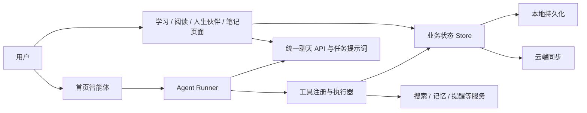

# 网站现状分析

日期：2026-11-09 · 对象：Mentora Web 当前工作区 · 状态：静态分析，运行与视觉待验证

## 1. 用户要改善的究竟是什么

用户认为核心模块大体成立，问题集中在回答没有达到期待、智能体不能充分直接操作业务、页面设计与整体布局不满意。因此不能把这次工作等同于换配色，或只加长提示词。

本次分析分别看四层：回答是否理解问题；业务动作是否存在且接入智能体；操作与结果是否可靠；界面是否让用户清楚知道当前位置、下一步和发生的变化。用户提供理想回答后，才能进一步判断其偏好属于深度、判断力、表达结构、个性化还是其他方面。

## 2. 当前架构与产品位置

以上表示代码调用关系，不代表所有页面业务都已经成为智能体工具。当前 Web 使用 Next.js、React、Zustand；首页工具链与业务页共同使用部分状态方法，但大量操作仍留在页面闭包内。包版本依据[当前 package.json](D:/zcode/agent/mentora/package.json)，本轮未升级依赖。

| 当前入口 | 已看到的职责 | 对规划的意义 |
|---|---|---|
| `/` | 首页会话、工具状态、确认卡、会话与产物侧栏 | 保留为通用入口，补齐上下文和结果操作 |
| `/learn` | 学习教练、读书伙伴、学习人生三个页签 | 当前导航概念混合，拟重新分组 |
| `/learn/new`、`/learn/[id]` | 引导、目标计划、阶段与每日学习、验收 | 第一条端到端打磨流程 |
| `/read/[id]` | 阅读目标、认知地图、路线、章节、讨论、验收和沉淀 | 已有很多功能，应做层次梳理和智能体接入 |
| `/council` | 单人物与圆桌会话、自定义人物 | 角色、发言、主持归纳与行动要分清 |
| `/brain` | 笔记与复习相关工作区 | 统一学习和阅读成果的去向 |
| `/life`、`/read` | 分别跳转 `/learn?tab=life`、`/learn?tab=read` | 老入口应兼容，名称和选中状态需统一 |
| `/settings`、认证、会员等 | 账户与使用基础设施 | 需要一并适配设计系统，不成为首批重构中心 |

证据：[AppShell](D:/zcode/agent/mentora/src/components/app-shell.tsx:45)、[学习工作台](D:/zcode/agent/mentora/src/app/learn/page.tsx:42)、[阅读页](D:/zcode/agent/mentora/src/app/read/[id]/page.tsx:1356)、[人生伙伴](D:/zcode/agent/mentora/src/app/council/page.tsx:70)。详情页本轮为针对性分段阅读，不能宣称页面全部逐行审计完毕。

## 3. 已确认的主要差距

“源码事实”表示当前代码可以直接支持该描述；“体验假设”必须通过实测或用户样例检验。以下不是本轮已经复现的线上故障列表。

| 编号 | 源码事实或历史事实 | 对用户的可能影响 | 对应需求 |
|---|---|---|---|
| F01 | `regenerate_phase` 已存在，但重排的是单阶段的天级目录；不是任意修改阶段的完整编辑接口 | “第三阶段延后、加实战、保留已完成日”等复杂要求不能统一落实 | AG-03、AG-04 |
| F02 | 阶段定位使用主题/阶段名包含匹配；省略阶段时会尝试当前阶段或首阶段 | 多个相近目标时可能选错，应先锁定 ID 或消歧 | AG-01 |
| F03 | 重排确认卡先确认请求；具体新目录在执行时才生成并写入 | 用户尚未看到新方案就决定替换，难以讨论某一项 | AG-02、AG-03 |
| F04 | 阶段重排已有快照和按标题复用 ID；旧天保留在 `plan.days`，历史最多五份 | 保护已有数据的基础存在，但“保留”“归档”“计入当前进度”需明确 | AG-04、DATA-01 |
| F05 | 阅读页有改目标、重排路线、节点排序和状态方法；首页工具表只有书架列表、加书和恢复入口等 | 用户在首页表达修改阅读路线时，不能直接调用页面已有操作 | AG-05、READ-01 |
| F06 | 人生伙伴工具可列会话、新建会话、返回入口；未覆盖页面完整圆桌交互 | 创建空会话不等于已经完成一场讨论 | AG-06、LIFE-01 |
| F07 | `create_goal` 工具声明接受 background，执行时也读取它，但草稿构造未传入 background | 已讲过的背景在交接处丢失的静态数据通路缺口 | AQ-02、AG-05 |
| F08 | 首页向模型传最近九条会话；默认状态优先取首个 active 目标 | 长对话和多目标情况下可能忘掉约束或错认对象 | AQ-02、AG-01 |
| F09 | `make_quiz` 从首个活跃目标的知识点生成模板题，缺少时重复泛化问题 | “针对刚讲内容出题”的工具描述与实际内容选择不完全对应 | AQ-03 |
| F10 | 深讲提示词固定要求九步骨架；带图片默认进入深讲且要求先确认读图内容 | 可能出现过长、套模板或不必要停顿；须用用户样例验证 | AQ-01 |
| F11 | 首页发起模型请求前就把“思考”标为完成；计划按工具批次推进 | 展示的过程不一定代表真正完成了某项工作 | PROC-01 |
| F12 | 流式正文基于已过滤文本再次拼接、过滤；遇工具调用会清空 pending | 存在流式内容丢失或跳动风险；需要分片与浏览器测试 | UX-02 |
| F13 | 首页只显示最近十条消息；发送按钮要求输入非空，send 函数则允许只有图片 | 历史查找和图片输入的入口行为不一致 | UX-02 |
| F14 | `/learn` 页签点击只修改本地 state；URL 参数仅初始化读取 | 刷新、后退、分享链接可能与当前页签不一致 | UX-01 |
| F15 | 当前回答区域出现 12.5px 正文字号；阅读页多个区域使用约 10.5–13px 文本，并可呈现三栏 | 存在阅读密度偏高的假设，不能替代实际宽度与视觉评估 | UX-03、READ-01 |
| F16 | 首页智能体、使用助手、学习/阅读/人物对话各有入口与上下文 | 用户可能不清楚在哪里继续同一任务，需要统一任务上下文规则 | UX-01、AQ-02 |

证据定位：F01–F06 见[工具表](D:/zcode/agent/mentora/src/lib/agent/protocol.ts:26)、[工具校验](D:/zcode/agent/mentora/src/lib/agent/tool-executors.ts:506)、[阶段重排实现](D:/zcode/agent/mentora/src/lib/agent/phase-regen.ts:109)、[阅读节点操作](D:/zcode/agent/mentora/src/app/read/[id]/page.tsx:1601)。F07 见[创建草稿](D:/zcode/agent/mentora/src/lib/agent/tool-executors.ts:576)与[执行创建](D:/zcode/agent/mentora/src/lib/agent/tool-executors.ts:686)。F08、F11–F13 见[首页发送和流式处理](D:/zcode/agent/mentora/src/components/agent-home.tsx:226)。F09 见[工具执行器](D:/zcode/agent/mentora/src/lib/agent/tool-executors.ts)，F10 见[Agent 提示词](D:/zcode/agent/mentora/src/lib/ai/prompts.ts:1711)，F14 见[页签实现](D:/zcode/agent/mentora/src/app/learn/page.tsx:43)，F15 见[阅读状态面板](D:/zcode/agent/mentora/src/app/read/[id]/page.tsx:1117)。

另外，资源修改工具目前只处理视频类约束，跳过未展开的占位天，执行最多前五个可处理日。产品不能将它描述为“整阶段任意资源已全部替换”。应显示覆盖范围、成功数、跳过数和剩余项。证据：[约束校验](D:/zcode/agent/mentora/src/lib/agent/tool-executors.ts:534)、[执行范围](D:/zcode/agent/mentora/src/lib/agent/tool-executors.ts:840)。

## 4. 回答质量的现状不能用旧通过率代替

[2026-11-06 质量基线](D:/zcode/agent/mentora/docs/QUALITY-BASELINE-DS-2026-11-06.md)记录过 C/数据结构深讲案例的结构检查与后续意图实验。需要保留三个区别：

- 深讲实验使用 `noTools=true`；结构检查通过不证明工具能完成任务，也不证明用户学懂。
- 意图实验曾报告 API 15/30、浏览器单批 20/30，后者受额度影响；三次合并至少成功一次为 27/30，不能写成稳定单次成功率 90%。
- 旧实验版本、模型和题型有限。本轮没有重新执行，不能作为当前版本质量基线。

当前需要冻结一批用户真实问题，用同样上下文分别跑旧版和候选版，评价正确性、理解程度、解释价值、个性化和表达；工具任务另外检查真实对象变化。指标方法见交付计划。

## 5. 什么应保留，什么需要调整

**保留并利用：** 学习目标/阶段/日结构、已有掌握与验收记录、阅读目标和多种路线、笔记沉淀、人物与圆桌、工具协议、确认卡、阶段历史和现有测试基础。不能因换 UI 就重建用户数据，也不能把核心模块删成一个聊天框。

**需要产品级调整：** 全站的导航命名；主智能体与专业工作区的关系；从自然语言到精确操作的能力覆盖；编辑前后对比和恢复体验；长回答排版；回答质量评测标准。

**技术方案阶段再决定：** 是否抽取统一业务命令层、事件模型如何扩展、聊天 UI 库如何适配现有流、状态同步和版本冲突如何处理。本轮不预设必须重写 Runner、迁移数据库或更换模型。

## 6. 研究仍缺少的证据

| 尚缺输入 | 为什么需要 | 当前处理 |
|---|---|---|
| 用户承诺发送的理想回答样例 | 冻结其认可的回答标准 | PRD 给出基础标准，风格偏好保持待定 |
| 当前网站真实页面与可用账户下的流程 | 验证视觉、导航和交互问题 | 浏览器访问被权限检查拒绝，未实测 |
| 当前模型/提供商下的固定样本基线 | 判断是提示词、上下文、执行器还是模型能力瓶颈 | 不提前将换模型当作结论 |
| 全业务操作的页面逐项走查 | 补齐“全站可操作”的最后分母 | 能力矩阵是初始清单，未映射操作列为缺口，不能默默排除 |
| 流量、失败率、成本、延迟、用户留存 | 判断投入和发布阈值 | 不编造数字；PRD 中数值均标为建议目标 |

## 7. 与旧记录的关系

记忆项目时间线记载 Qoder 国内版在 2026-10-27 的前后端与架构阅读会话；用户已明确本次重新读取当前文件。旧[Agent PRD](D:/zcode/agent/mentora/docs/PRD-AGENT-2026-10-26.md)提出过统一入口、过程外显与工作区交接；新文档继续这些方向，把用户本轮补充的精确编辑和全站能力覆盖明确化。旧插件与小程序计划暂不进入本轮实施范围。
